# Cas d'usage et diagrammes

> Illustration des fonctionnalités réalisées au 2026-10-07 (voir `08-synthese-fonctionnalites.md`).
> Les schémas sont écrits en **Mermaid** : ils s'affichent directement sur GitHub, et dans VS Code avec une extension d'aperçu Markdown qui gère Mermaid.
> Ils décrivent ce que fait le code. Les 16 premiers schémas ont été validés par l'analyseur syntaxique de Mermaid le 03/10 ; ceux ajoutés le 07/10 (cas d'usage UC19 à UC22, séquence 4.10, états 5.4, architecture) ne l'ont pas été. Le rendu visuel n'a pas été contrôlé à l'œil, signalez tout schéma qui s'affiche mal.

Sommaire : 1. Acteurs · 2. Cas d'usage · 3. Parcours complet d'une date · 4. Diagrammes de séquence · 5. Cycles de vie (états) · 6. Modèle de données · 7. Architecture.

---

## 1. Acteurs

| Acteur | Rôle | Dans l'application |
|---|---|---|
| **Artiste / propriétaire** | Utilise l'application pour gérer ses dates | Accès complet, seul à modifier « Ma structure » |
| **Membre** | Autre personne de la même structure | Accès aux données, consulte « Ma structure » sans la modifier |
| **Organisateur** | Le client (mairie, festival, salle, association…) | **N'a pas de compte** : reçoit les PDF par l'artiste, signe hors de l'application |
| **Équipe sur la route** | Musiciens, techniciens, accompagnants | **N'a pas de compte** : ouvre la feuille de route avec le lien secret que l'artiste lui envoie |
| **Visiteur** | Toute personne sur le site | Lit les pages légales sans compte |
| **Système** | L'application elle-même | Numérote, fige, génère les PDF, contrôle l'accès, purge les comptes supprimés après 30 jours |

---

## 2. Cas d'usage

### 2.1 Vue d'ensemble

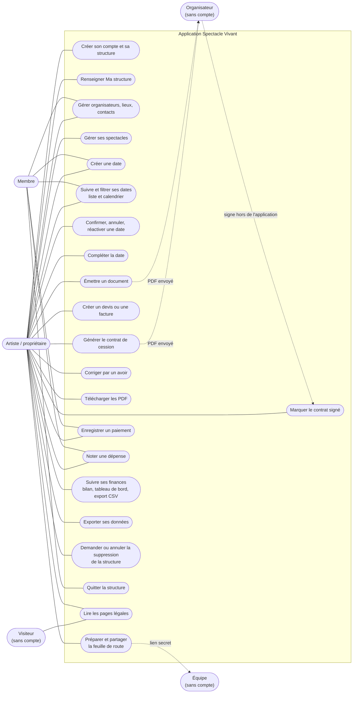

Le membre fait tout ce que fait l'artiste **sauf modifier « Ma structure »** (il la consulte), exporter les données ou demander la suppression (réservés au propriétaire) ; il peut en revanche quitter la structure. Il est représenté sur les cas principaux pour la lisibilité (le diagramme n'en montre qu'une partie).

### 2.2 Fiches des cas d'usage principaux

**UC1 — Créer son compte et sa structure**
- *Déclencheur* : première connexion.
- *Scénario* : l'utilisateur s'inscrit → est redirigé vers « Bienvenue » → saisit le nom, la forme juridique, le régime de TVA → la structure et son lien propriétaire sont créés → il arrive sur l'assistant de création d'une date.
- *Résultat* : une structure vide, isolée de toutes les autres.

**UC5 — Créer une date** (assistant en 5 étapes)
- *Scénario* : choisir ou créer un spectacle → un organisateur → un lieu → saisir date, prix HT, fin d'option, conditions → relire le récapitulatif → valider.
- *Cas d'erreur* : une étape sautée renvoie à l'étape 1 ; un spectacle, organisateur ou lieu d'une autre structure est refusé même si son identifiant est falsifié.
- *Résultat* : une date au statut « option ».

**UC7 — Confirmer, annuler, réactiver**
- *Règles* : option → confirmée ; confirmée ou signée → annulée ; l'annulation demande une confirmation et garde l'historique ; la réactivation remet « en option » (ou « signée » si le contrat est signé).
- *Cas d'erreur* : une transition interdite est refusée avec un message (un double clic ne rejoue rien).

**UC9 — Générer le contrat**
- *Précondition* : date non annulée.
- *Scénario* : « Compléter la date » (facultatif) → « Aperçu » → « Générer le contrat » → une version numérotée est enregistrée → téléchargement.
- *Variante* : régénérer ajoute une version, les anciennes restent.
- *Cas d'erreur* : date annulée sans contrat → refus ; contrat signé → plus de génération.

**UC10 — Marquer le contrat signé**
- *Préconditions* : date confirmée et au moins une version générée.
- *Scénario* : « Marquer comme signé » → écran « Vous allez figer la version N » → l'artiste confirme que la signature a eu lieu hors de l'application, ajoute éventuellement le scan → la version est figée, le contrat et la date passent à « signée ».
- *Cas d'erreur* : fichier qui n'est pas un PDF ou de plus de 10 Mo → refusé ; date non confirmée → refusé.

**UC11/UC12 — Créer puis émettre une facture**
- *Scénario* : « Devis et factures » → « Facture d'acompte » → brouillon avec la ligne suggérée (30 % du prix) → ajuster les lignes → s'il manque une information, la page la liste → « Émettre » → confirmation → numéro attribué, informations figées, PDF créé.
- *Cas d'erreur* : adresse, SIRET, numéro ou taux de TVA, ou adresse de facturation manquants → émission refusée avec la liste ; document déjà émis → refusé, aucun numéro consommé.

**UC13 — Corriger par un avoir**
- *Précondition* : facture émise avec un montant encore créditable.
- *Scénario* : « Créer un avoir » → brouillon qui reprend les lignes en négatif (modifiable pour un avoir partiel) → « Émettre ».
- *Règles* : un avoir ne dépasse jamais la facture ; un avoir total marque la facture « Annulée par avoir ».

**UC15 — Préparer et partager la feuille de route**
- *Scénario* : sur la fiche de la date, « Feuille de route » → les créneaux Arrivée, Balances et Concert sont pré-remplis avec les horaires de la date → l'artiste ajoute des créneaux, l'hébergement, les repas, l'équipe et des notes → « Activer le partage » → il copie le lien et l'envoie à l'équipe.
- *Ce que voit l'équipe* : une page lisible sur téléphone, sans compte : lieu, programme, hébergement, repas, équipe, contacts du lieu, boutons « Appeler », « Itinéraire » et « Copier l'adresse », export PDF. **Jamais** le prix, les conditions, le contrat, les factures, l'organisateur facturé ni les e-mails.
- *Cas d'erreur* : lien inconnu ou partage arrêté → page introuvable (404). « Arrêter le partage » tue le lien pour de bon ; réactiver en crée un nouveau.

**UC16 — Enregistrer un paiement**
- *Précondition* : facture émise (ni brouillon, ni avoir, ni annulée).
- *Scénario* : « Paiements et dépenses » → sur la facture, saisir montant, date et mode (le reste à payer est proposé) → la facture passe à « Payée » quand le total est atteint.
- *Cas d'erreur* : un paiement qui dépasse le reste à payer est refusé ; un montant nul ou négatif aussi. Un paiement peut être modifié ou supprimé : la facture revient alors à « Émise » si le total n'est plus atteint.

**UC17 — Noter une dépense**
- *Scénario* : « Paiements et dépenses » → catégorie, libellé, montant, date, justificatif facultatif (PDF, JPEG ou PNG, 10 Mo maximum).
- *Cas d'erreur* : un fichier qui n'est pas un vrai PDF ou une vraie image est refusé, même avec la bonne extension.

**UC18 — Suivre ses finances**
- *Bilan d'une date* : prévu, facturé, encaissé, reste à encaisser, dépensé, résultat (encaissé moins dépensé), en TTC et en euros entiers à l'affichage.
- *Tableau de bord* (page d'accueil) : facturé et encaissé de l'année, factures à encaisser (avec le retard), dates confirmées sans contrat, prochaines dates.
- *Export CSV* : factures et avoirs, recettes, dépenses, sur la période choisie, prêts pour Excel ou le comptable.

**UC19 — Exporter ses données**
- *Scénario* : « Ma structure » → « Exporter mes données » → un ZIP est téléchargé : CSV (spectacles, organisateurs, lieux, contacts, dates, finances) et fichiers stockés (contrats, PDF, justificatifs).
- *Isolation* : le ZIP ne contient que les données de sa propre structure.

**UC20 — Demander ou annuler la suppression de la structure**
- *Précondition* : être propriétaire.
- *Scénario* : « Supprimer ma structure » → l'utilisateur saisit le nom de la structure et son mot de passe → la suppression est **programmée à 30 jours** ; elle peut être annulée pendant ce délai. Passé le délai, la commande `purge_deleted_tenants` efface les données et les fichiers.
- *Cas d'erreur* : nom ou mot de passe faux → refus ; un simple membre → accès refusé ; demander deux fois garde la première date.
- ⚠️ Les factures émises sont supprimées avec le reste : conservation légale de 10 ans à valider avec un comptable.

**UC21 — Quitter la structure**
- *Scénario* : un membre clique sur « Quitter » et perd l'accès aux données de la structure.
- *Cas d'erreur* : le dernier propriétaire ne peut pas partir (il doit supprimer la structure ou la confier).

**UC22 — Lire les pages légales**
- *Scénario* : sans compte, ouvrir mentions légales, conditions d'utilisation ou confidentialité. Les textes sont des gabarits provisoires (« [À compléter] ») avant relecture.

---

## 3. Parcours complet d'une date

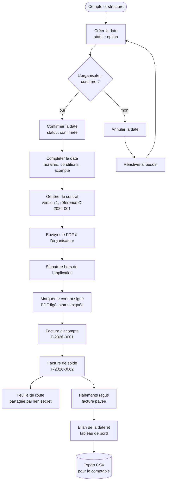

La feuille de route se prépare dès que la date existe ; elle est placée ici par commodité. Les dépenses se saisissent à tout moment et alimentent le bilan.

---

## 4. Diagrammes de séquence

### 4.1 Création d'une date par l'assistant

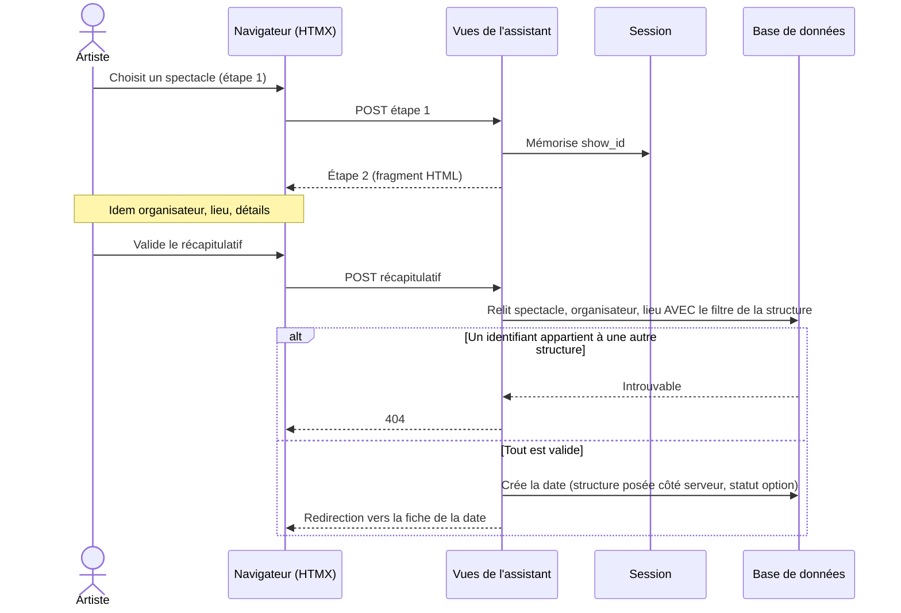

### 4.2 Génération d'une version de contrat

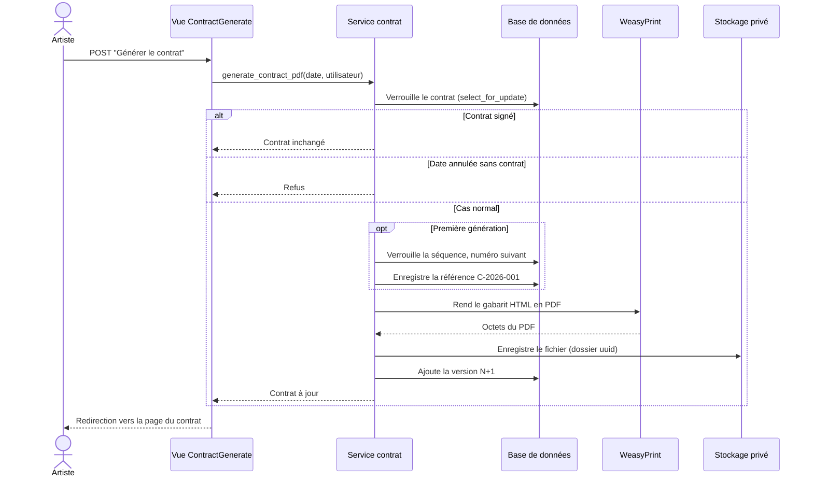

### 4.3 Marquage « signé »

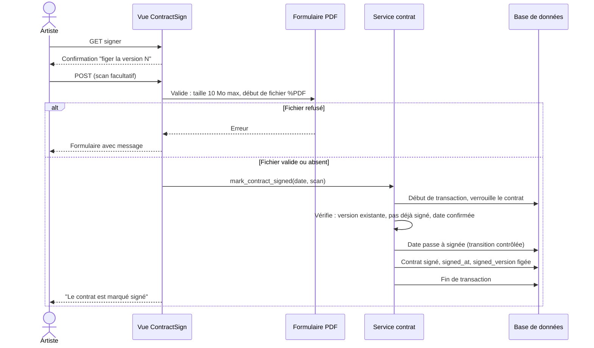

Tout se passe dans une seule transaction : le contrat et la date sont signés ensemble, ou pas du tout.

### 4.4 Émission d'une facture

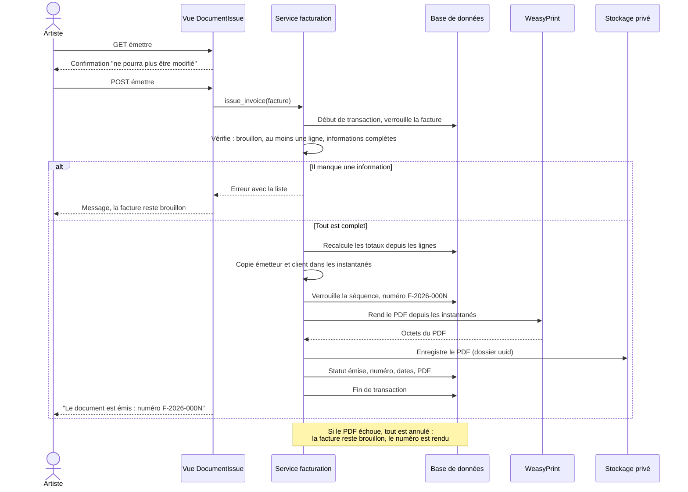

### 4.5 Avoir

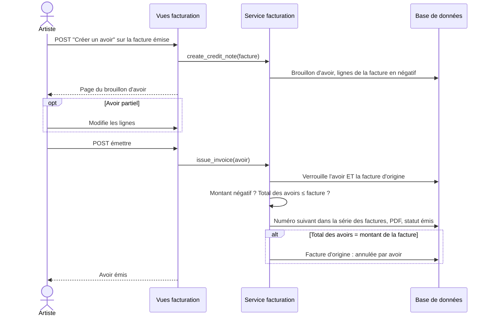

### 4.6 Modification d'une ligne en direct (HTMX)

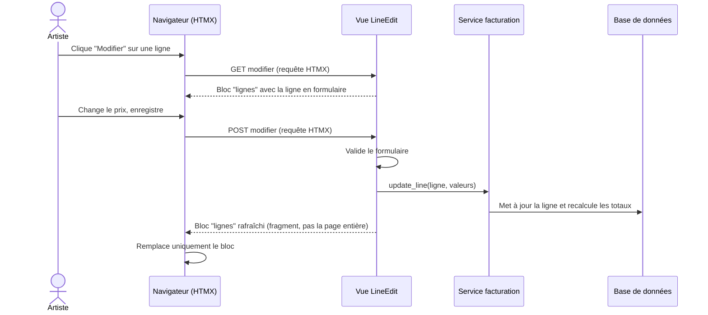

Sans JavaScript, les mêmes adresses fonctionnent par rechargement de page (redirection au lieu du fragment).

### 4.7 Accès protégé à un fichier

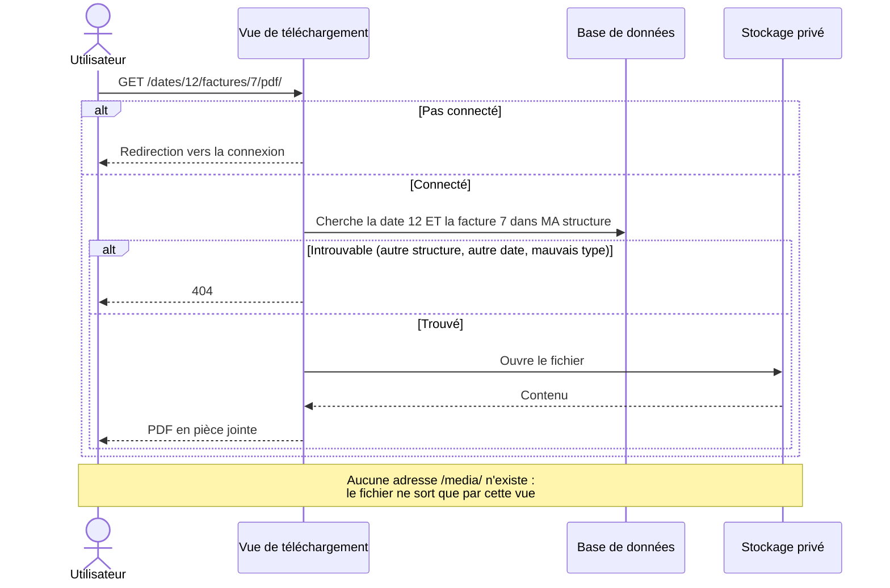

### 4.8 Lien secret de la feuille de route

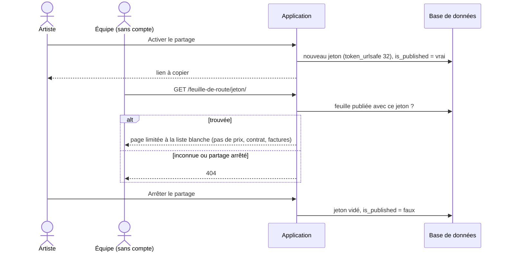

Le lien ne montre que les données d'une liste blanche (`public_context`). La page est servie avec `no-store`, `noindex` et `no-referrer`, parce que le jeton est dans l'adresse.

### 4.9 Enregistrement d'un paiement

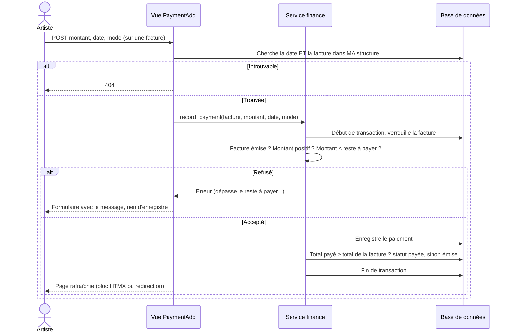

Modifier ou supprimer un paiement passe par le même verrou et recalcule le statut : une facture « payée » revient à « émise » si le total n'est plus atteint.

### 4.10 Suppression de la structure

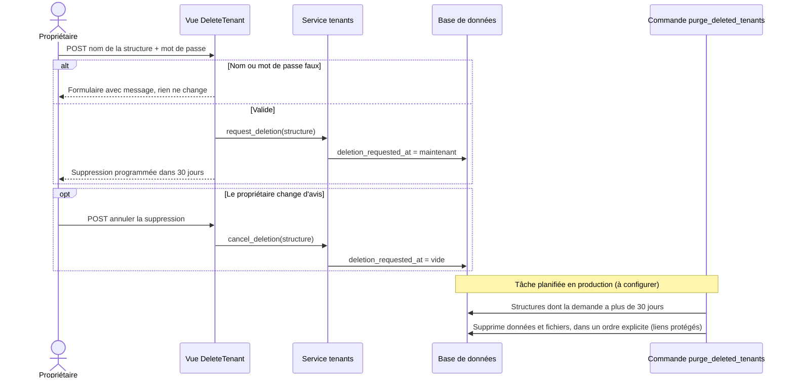

La suppression n'est jamais immédiate : le délai de 30 jours laisse le temps de se rétracter ou d'exporter ses données.

---

## 5. Cycles de vie (diagrammes d'états)

### 5.1 Une date

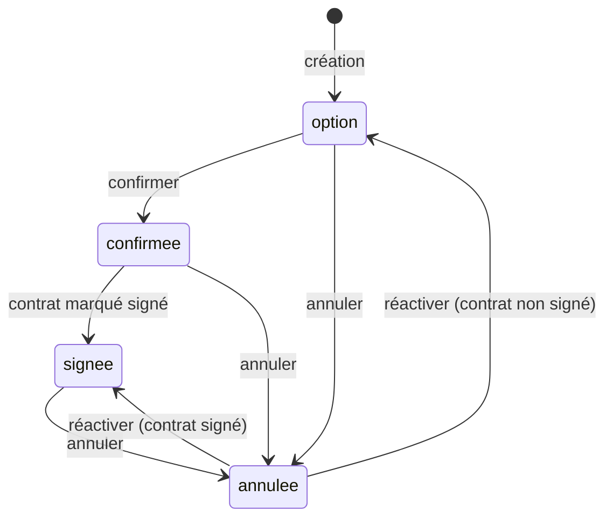

Le passage à « signée » ne se fait que par le marquage du contrat. Rien n'est annulé automatiquement, même quand une option expire.

### 5.2 Un contrat

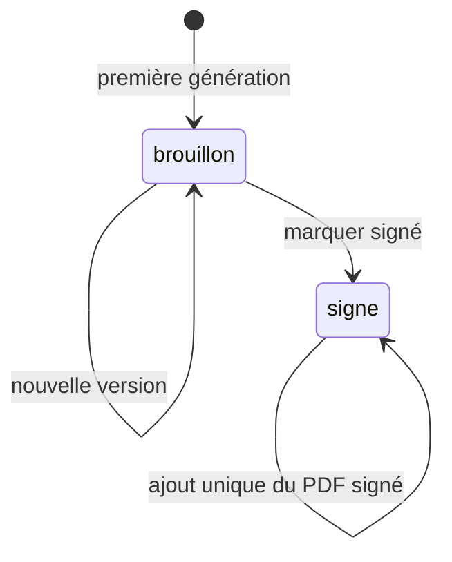

Un contrat signé ne bouge plus : la version figée est protégée contre la suppression et aucune version n'est ajoutée.

### 5.3 Une facture

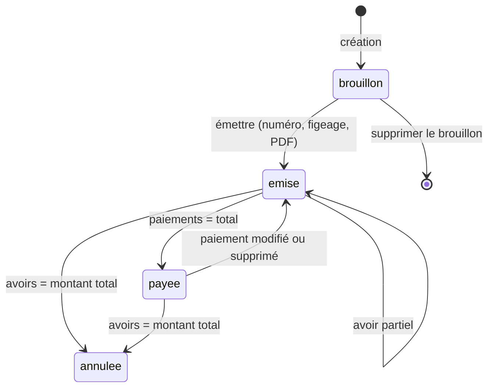

Une facture émise ne peut ni être modifiée ni supprimée ; seul son statut bouge, avec les paiements. Une facture payée reste créditable. Un devis suit le même cycle, sans avoir ni paiement.

### 5.4 Une structure

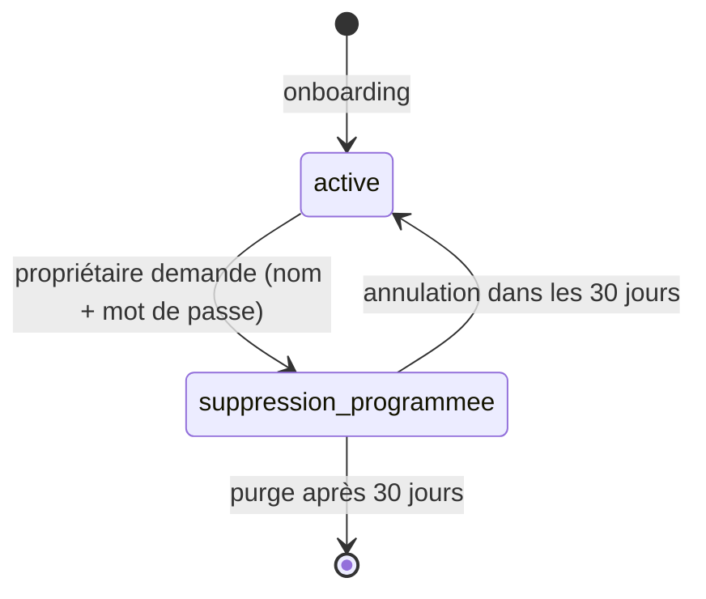

Pendant le délai, la structure existe encore et l'export reste possible.

---

## 6. Modèle de données

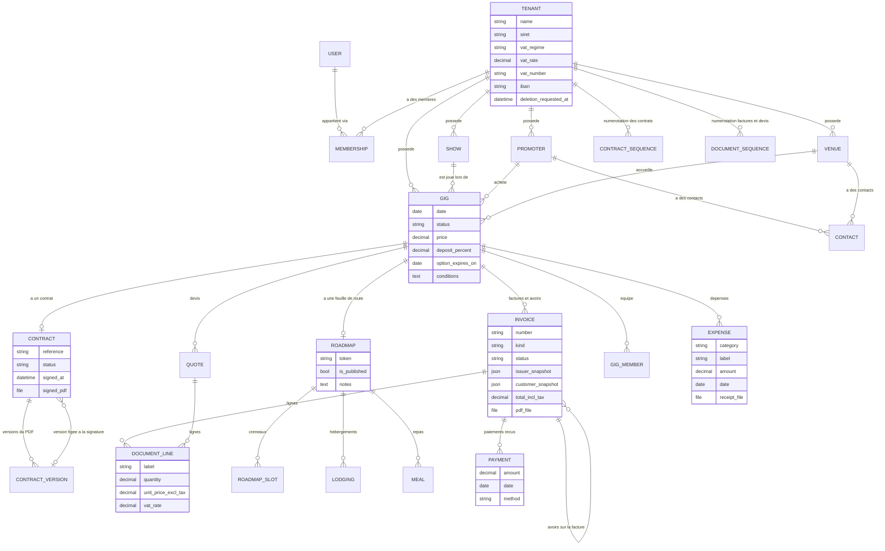

Règle d'or : **tous** les modèles métier (tout sauf `USER`) portent une clé vers `TENANT` (via `TenantOwnedModel`). C'est ce qui garantit l'isolation des structures. Les contraintes en base : un contact a un seul parent, un avoir est lié à sa facture (et seulement lui), une ligne a un seul document, un numéro est unique par structure, le jeton d'une feuille de route est unique, un montant de paiement ou de dépense est strictement positif.

---

## 7. Architecture

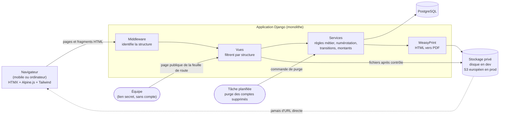

Les pages légales et la page publique de la feuille de route sont les seules vues sans connexion (hors inscription et connexion). La feuille de route ne passe que par le jeton, et n'expose qu'une liste blanche de données.

Choix assumés : un seul programme (pas d'API séparée), des pages rendues par le serveur avec de petits échanges HTMX, la logique métier dans des services testables, et les fichiers servis uniquement par des vues qui vérifient la structure.
