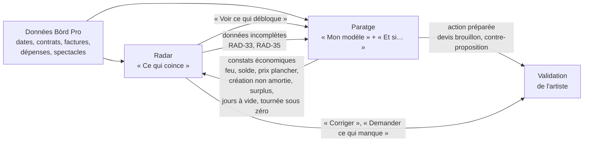

# Bòrd Pro — RADAR, le copilote

**Spécification pour le développement · v1 · 12/11/2026**
Document jumeau : `03-PARATGE-agent.md`. Les deux remplacent la spécification commune v4 (`archives/02-SPEC-radar-paratge-developpeur.md`), dont ils reprennent toutes les décisions (D1 à D22).
Rappel `CLAUDE.md` §9 : plan validé avant toute modification de modèles, migrations, multi-tenant ou PDF.

---

## 0. En bref

**Radar voit ce qui coince.** Il relit en continu les dates, contrats, devis, factures, feuilles de route, l'équipe et les obligations, et prévient l'artiste dès qu'une information manque, qu'un élément ne colle pas ou qu'une échéance approche. Il joue le rôle de l'administrateur de compagnie que les petites structures n'ont pas.

**Radar ne calcule pas l'économie d'une date** : c'est le rôle de Paratge. Radar affiche les constats économiques que Paratge lui fournit (voir §9, interconnexion), mais il ne les produit pas.

| | Radar |
| --- | --- |
| Rôle | Copilote : observe, prévient, oriente vers la bonne action |
| Question à laquelle il répond | « Qu'est-ce qui manque, ne colle pas ou arrive à échéance ? » |
| Domaine | Conformité, documents, logistique, équipe, échéances, obligations |
| Ce qu'il ne fait jamais | Modifier une donnée, envoyer un message, bloquer une action, calculer des charges sociales |
| Offre (fait : catalogue Stripe du 11/11/2026) | **Pilotage** et **Collectif** (« Radar à venir ») |
| À l'écran | « Ce qui coince » |

---

## 1. Rôle et limites

1. **Radar observe et prévient, il ne modifie rien** (D17). Ses boutons mènent à l'endroit où corriger (« Corriger »), ou préparent une demande d'information que l'artiste envoie lui-même (« Demander ce qui manque », §6).
2. **Aucune alerte ne bloque** (D5). Les cas graves (gravité « Important ») demandent une confirmation explicite, mémorisée.
3. **Chaque alerte dit quoi faire** : ce qui ne va pas → pourquoi c'est important → un bouton vers la bonne action.
4. **Chaque alerte s'explique** : « Pourquoi cette alerte ? » (§6). Une règle réglementaire sans source officielle n'est pas mise en ligne.
5. **Le pop-up est rare** : seulement aux actions engageantes (signer, émettre une facture, envoyer un devis, partager une feuille de route, confirmer une date).
6. **Vocabulaire** : celui du métier. Jamais « tiers », « entité », « client », « écriture comptable ».

**Règle de partage avec Paratge :** Radar s'occupe de **ce qui est** (les faits saisis, les documents, les échéances). Paratge s'occupe de **ce que vaut une date et de ce qui pourrait être** (modèle économique, projections, leviers). En cas de doute sur qui fait quoi, appliquer cette règle.

---

## 2. Comportement à l'écran

| Endroit | Quand | Ce que voit l'artiste |
| --- | --- | --- |
| **Pastille** sur chaque fiche (date, contrat, feuille de route, spectacle) et dans la liste des dates | En permanence | Un rond et un nombre par gravité ; au clic, la liste des alertes de la fiche |
| **Fil de vie d'une date** (V2) | Sur la fiche date ; en miniature dans la liste | 5 cases : contrat, feuille de route, équipe, budget, facture |
| **Écran « Ce qui coince »** | Entrée de menu avec compteur | Toutes les alertes ouvertes, triées par gravité puis par date la plus proche ; filtres par famille |
| **Pop-up** | Aux actions engageantes | Les seules alertes liées à l'action ; « Corriger » ou « Continuer quand même » ; **un seul pop-up par action**, partagé avec Paratge (§9) |
| **Bandeau d'information** | Changements réglementaires | Texte court + lien vers la source officielle |
| **E-mail récapitulatif** (R5) | Une fois par semaine, facultatif | Les alertes à corriger dans les 14 jours (dépend de Brevo) |

Statuts d'une alerte (à partir de R0) : ouverte · en attente (une demande est partie) · ignorée · traitée · fermée. Une alerte se ferme d'elle-même quand la condition disparaît ; une alerte ignorée revient si les données changent.

Gravités : **Important** (rouge, confirmation explicite) · **À corriger** (orange) · **À savoir** (gris/bleu). Couleurs d'état réservées aux états (charte) ; jamais la couleur seule (icône ou mot en plus).

---

## 3. Les règles propres à Radar

Gravité : **I** = Important, **C** = À corriger, **S** = À savoir. Moment : *pop-up*, *pastille*, *nuit* (commande quotidienne), *bandeau*.

### A. Ma structure
| ID | Condition | Grav. | Moment | Jalon |
| --- | --- | --- | --- | --- |
| RAD-01 | SIRET, adresse ou nom légal absent à l'émission d'un devis, contrat ou facture | I | pop-up | V0 |
| RAD-02 | IBAN/BIC absent à l'émission d'une facture | C | pop-up | V0 |
| RAD-03 | Plus de 6 représentations confirmées dans l'année civile sans n° de récépissé d'entrepreneur de spectacles | C | pastille + pop-up à la 7e | R2 |
| RAD-04 | Régime de TVA non renseigné : la mention « TVA non applicable, art. 293 B du CGI » ne peut pas être décidée | C | pop-up 1re facture | V0 |

### B. Contrat et booking
| ID | Condition | Grav. | Moment | Jalon |
| --- | --- | --- | --- | --- |
| RAD-10 | Champ obligatoire du contrat vide au passage « envoyé » ou « signé » | I | pop-up | V0 |
| RAD-11 | Date, lieu ou prix du contrat ≠ ceux de la date ou du devis accepté | C | pastille + pop-up | V0 |
| RAD-12 | Contrat non signé à J-30 (réglable) | C | nuit | R2 |
| RAD-13 | Organisateur sans n° de licence ni mention « occasionnel » | S | pastille | R2 |
| RAD-14 | Contrat signé, date passée, aucune facture | C | nuit | R2 |
| RAD-15 | Acompte prévu non reçu à l'échéance | C | nuit | R2 |
| RAD-16 | Option échue ou date sans statut clair | C | nuit | R2 |
| RAD-17 | Date confirmée, contrat non envoyé après X jours | C | nuit | R2 |

### C. Feuille de route et logistique
| ID | Condition | Grav. | Moment | Jalon |
| --- | --- | --- | --- | --- |
| RAD-20 | À J-7 (réglable) : adresse, arrivée, balances, concert ou contact sur place manquant | C | nuit (V0 : à l'affichage) + pop-up au partage | V0 |
| RAD-21 | Fin après minuit sans hébergement saisi | S | pastille | R0 |
| RAD-22 | Horaires incohérents (balances après concert, chevauchements, créneau plus court que le spectacle) | C | pastille + pop-up | V0 |
| RAD-23 | Feuille de route non partagée à J-3 | S | nuit | R2 |
| RAD-24 | Un membre prévu sur deux dates le même jour | C | pastille | R0 |
| RAD-25 | Équipe de la date inférieure aux artistes et techniciens du spectacle | S | pastille | R0 |
| RAD-26 | Date sans ville ni adresse | C | pastille | V0 |
| RAD-27 | Distance entre deux dates > seuil | S | pastille | R4 (reporté, D7) |
| RAD-28 | Dates rapprochées et éloignées : « point à vérifier » | S | pastille | R4 (reporté, D7) |

### D. Données de la date (faits saisis, sans modèle)
| ID | Condition | Grav. | Moment | Jalon |
| --- | --- | --- | --- | --- |
| RAD-29 | **Nouveau (à valider)** — Dépenses saisies pour la date supérieures au prix de cession. Calcul simple sur les faits, sans repères ni modèle : c'est l'alerte de rentabilité disponible dans l'offre Pilotage | C | pastille + pop-up à la signature | V0 |
| RAD-35 | Prix de cession ou frais de la date non renseignés | C | pastille | V0 |

### F. Argent et échéances
| ID | Condition | Grav. | Moment | Jalon |
| --- | --- | --- | --- | --- |
| RAD-50 | Facture échue non payée | C | nuit | R2 |
| RAD-51 | Date passée depuis 30 jours, encaissé ≠ prévu | C | nuit | R2 |
| RAD-52 | Facture sans échéance ou au-delà du délai légal (à valider) | C | pop-up | R0 |
| RAD-53 | Dépense d'équipe en attente de validation depuis plus de 7 jours | S | nuit | R2 |
| RAD-54 | Date passée non clôturée (jouée, annulée…) | C | nuit | R2 |
| RAD-55 | Prochaine action échue | C | nuit | R1 |

### G. Social et réglementaire (signaler, jamais calculer de charges)
| ID | Condition | Grav. | Moment | Jalon |
| --- | --- | --- | --- | --- |
| RAD-60 | Rappel de déclaration préalable à l'embauche avant la date | S | nuit | R2 |
| RAD-61 | GUSO : déclaration et paiement non cochés 15 jours après la fin du contrat | C | nuit | R2 |
| RAD-62 | Membre sans n° GUSO / sécurité sociale avant la date (visible du propriétaire seul) | C | nuit | R2 |
| RAD-63 | Information : émission de factures électroniques obligatoire au 1er septembre 2027 pour les TPE et micro-entreprises | S | bandeau | R5 |
| RAD-64 | Information : déclaration des intermittents en DSN (bascule jusqu'à fin mars 2027) | S | bandeau | R5 |

Retirée : RAD-05 (seuil de TVA, D16).

**Liste « Avant de signer »** (affichée dans le pop-up de signature, à cocher, sans blocage) : licence adaptée et numéro sur le contrat ; chaque artiste payé en CDDU avec bulletin ; cachets au-dessus des minima de la convention collective ; GUSO seulement si le spectacle n'est pas l'activité principale ; défraiements séparés du salaire et dans les plafonds URSSAF ; délais de paiement de l'organisateur anticipés. **À faire relire (D6).**

### Règles économiques affichées par Radar mais calculées par Paratge (offre Collectif)

RAD-30 à RAD-34, RAD-36, RAD-37, RAD-40 à RAD-42, RAD-45 : voir `03-PARATGE-agent.md` §8. Radar les affiche avec le même format, les mêmes pastilles et le même écran « Ce qui coince ».

---

## 4. Délais et réglages (D16)

Contrat non signé : 30 jours · feuille de route incomplète : 7 jours · dépassement des dépenses : 15 % · règles désactivables par structure. Tous modifiables par chaque structure. Pas d'alerte sur le seuil de TVA.

---

## 5. Données

| Objet | Existe ? | À faire pour Radar |
| --- | --- | --- |
| `Alert` | Non (pas en V0) | `TenantOwnedModel` : `rule_code`, `severity`, objet concerné, `message`, `data` (JSON des montants ou champs pris en compte), `status` (ouverte, en attente, ignorée, traitée, fermée), `first_seen`, `last_seen`, `dismissed_by`. Unicité (tenant, règle, objet). Test d'isolation |
| Réglages Radar sur `Tenant` | Non | Délais (J-30, J-7, 15 %), règles désactivées |
| `Tenant` | Oui | `licence_number`, `vat_regime`, `social_mode` (GUSO / DSN) |
| `Promoter` | Oui | `licence_number` (ou « organisateur occasionnel ») |
| `Gig` | Oui | `next_action`, `next_action_date`, `option_expires_on` |
| Cases « fait » | Non | DPAE faite, déclaration GUSO faite (sur `GigMember` ou la date) |

---

## 6. Fonctions de Radar

### « Pourquoi cette alerte ? » (PI-4, V0)
Sous chaque alerte : l'explication (2 phrases), « ce que ferait un administrateur » (1 phrase), la source officielle datée. Textes dans le registre des règles (code). Test : chaque règle a ses trois textes. Textes réglementaires relus par l'administrateur de production (D6).

### « Demander ce qui manque » (PI-1, R0)
Sur RAD-10, RAD-20, RAD-26 : un bouton crée le lien de complétion organisateur existant (7 jours, usage unique) **avec seulement les champs manquants**. Copie du lien ou `mailto:` pré-rempli, jamais d'envoi automatique. Alerte → « en attente ». Réponses validées par l'artiste avant application. **À valider :** rattacher PI-1 à Radar (il concerne la complétude, pas l'économie), donc disponible dès l'offre Pilotage.

### Visuels
- **V2 · Fil de vie d'une date** (V0) : 5 cases, miniature dans la liste.
- **V3 · Radar circulaire sur l'accueil** (à tester en pilote) : anneaux = temps, quarts = familles, points = alertes ; liste équivalente obligatoire.
- SVG généré côté serveur, pas de bibliothèque de graphiques.

---

## 7. Exigences techniques

- Règle = fonction pure, par exemple `rad_10_contract_missing_fields(contract) -> Finding | None` ; registre par objet et par action.
- **V0** : alertes calculées à l'affichage, sans enregistrement (pas de modèle `Alert`, pas de commande de nuit).
- **À partir de R0** : trois déclencheurs — à l'action (`check(action, obj)` avant d'exécuter), à l'enregistrement (appel explicite dans le service, pas de signal Django), chaque nuit (`radar_daily`, planificateur Scalingo, pas de Celery).
- Les règles économiques n'appellent **que** la fonction de calcul de Paratge (`apps/finance/services.py`) ; Radar ne recalcule jamais un solde lui-même.
- Tests par règle : déclenche / ne déclenche pas / cas limite ; isolation des tenants ; vue de chaque action engageante ; lexique des messages.

---

## 8. Feuille de route de Radar

| Jalon | Contenu Radar | Validation avant le suivant |
| --- | --- | --- |
| **V0** (avec Paratge V0) | RAD-01, 02, 04, 10, 11, 20, 22, 26, 29, 35 ; pop-up aux actions engageantes ; PI-4 ; V2 | Test 3 à 4 semaines avec 2 ou 3 artistes |
| R0 · Complétude | Modèle `Alert` et statuts, écran « Ce qui coince », RAD-21, 24, 25, 52 ; PI-1 | Aucune fausse alerte sur `seed_demo` |
| R1 | RAD-55 (prochaine action échue), affichage des règles économiques de Paratge | — |
| R2 · Échéances et obligations | `radar_daily` ; RAD-03, 12 à 17, 23, 50, 51, 53, 54, 60 à 62 ; liste « Avant de signer » | Relecture par un administrateur de production |
| R3 · Partage et export | Synthèse de tournée partageable sans montants internes (375 px), lien révocable à durée limitée, PDF, CSV | — |
| R4 · Géographie | Reporté (D7) : RAD-27, 28 | — |
| R5 | Récapitulatif e-mail, bandeaux RAD-63, 64 | Pilote |

Tout démarre après la fin du MVP (D12).

---

## 9. Interconnexion Radar ↔ Paratge

*(Section identique dans les deux documents.)*

**La règle de partage :** Radar = **ce qui est** (faits, documents, logistique, échéances, obligations). Paratge = **ce que vaut une date et ce qui pourrait être** (modèle économique, financements, projections, leviers, actions économiques préparées).

| Point de contact | Règle |
| --- | --- |
| **Un seul système d'alertes** | Radar. Paratge ne crée pas d'alertes à part : il fournit des **constats économiques** que Radar affiche comme des règles (RAD-30 à 34, 36, 37, 40 à 42, 45), avec le même format, les mêmes pastilles et le même écran |
| **Une seule formule** | Elle appartient à Paratge (`apps/finance/services.py`). Radar, le bilan et tous les écrans la lisent ; personne ne la recopie |
| **Le pont vers Paratge** | Chaque alerte économique porte un bouton « Voir ce qui débloque » qui ouvre les « Et si… » de Paratge sur la date ou la tournée concernée |
| **Le pont vers Radar** | Paratge affiche les alertes Radar de complétude de la date (RAD-33, RAD-35…), car un calcul sur des données incomplètes est faux |
| **Un seul pop-up par action** | À la signature, la même modale montre les alertes Radar (documents, logistique) **et** l'« avant / après » de Paratge |
| **Validation** | Aucun des deux n'envoie ni ne modifie sans l'artiste : Radar oriente, Paratge prépare, l'artiste valide |
| **Offres** (fait : catalogue Stripe du 11/11/2026) | **Pilotage** : Radar seul. **Collectif** : Radar + Paratge |
| **Radar sans Paratge** (Pilotage, à valider) | Radar fonctionne seul avec ses règles A, B, C, D (RAD-29, 35), F, G. Les règles économiques RAD-30 et suivantes sont absentes. Sous RAD-29, une mention discrète indique que Paratge (offre Collectif) montre ce qui peut débloquer la date |
| **Version 0** | Construite et testée **ensemble** (les artistes testeurs ont Radar + Paratge) |

Données partagées :

| Objet | Radar | Paratge |
| --- | --- | --- |
| Date (`Gig`) | lit ; règles de complétude, échéances | lit ; solde, feu, prix plancher |
| Contrat, devis, facture | lit ; règles de documents | lit ; crée un **devis brouillon** sur validation (contre-proposition) |
| Spectacle (`Show`) | lit (durée, équipe) | lit et écrit « Mon modèle » et ses financements |
| Dépenses, paiements | lit (RAD-29, 50, 51, 53) | lit ; ajoute la phase prévu / réel et les dépenses communes de tournée (R1) |
| Tournée (`Tour`) | lit (synthèse partagée, R3) | crée et calcule (R1) |
| Alertes (`Alert`) | crée et gère | fournit les constats ; ne crée rien directement |

---

## 10. À vérifier dans le code avant de commencer (pour Radar)

1. Le formulaire de complétion organisateur accepte-t-il une liste de champs variable ? (PI-1)
2. Le contrat a-t-il un champ « acompte » et un statut « envoyé » ? (RAD-15, RAD-17)
3. Le lien secret de la feuille de route a-t-il une date d'expiration ? (R3)
4. Quels statuts de date existent : option, confirmée, jouée, annulée ? (RAD-16, RAD-54)

## 11. Points à valider par le porteur du projet

- RAD-29 (dépenses saisies > prix) comme alerte de rentabilité de l'offre Pilotage.
- PI-1 « Demander ce qui manque » rattaché à Radar, donc disponible dès Pilotage.
- La mention vers Paratge sous RAD-29 dans l'offre Pilotage (discrète, sans relance).
- Le périmètre de l'offre Découverte (point ouvert du document Stripe).

## 12. Sources

- Catalogue Stripe du 11/11/2026 (document projet `claude/stripe-abonnements-bord-pro.md`).
- Spécification commune v4 du 08/11/2026 (`archives/`).
- Licence : https://www.culture.gouv.fr/thematiques/theatre-spectacles/pour-les-professionnels/plateforme-des-entrepreneurs-de-spectacles-vivants-platesv/fiche-4.2.-que-dois-je-declarer-selon-mon-activite-et-mon-statut-juridique
- GUSO : https://www.guso.fr/information/files/live/sites/Guso/files/Pdf/Guso_Brochure_12-pages_Decembre2022_WEB.pdf
- DSN intermittents : https://www.francetravail.fr/spectacle/spectacle--intermittents/intermittents-du-spectacle-ce-qu.html
- Facture électronique : https://www.cegid.com/fr/facturation-electronique/facture-electronique-obligatoire/calendrier-facture-electronique/
- TVA : https://www.legifiscal.fr/actualites-fiscales/4289-adoption-definitive-texte-seuils-franchise-base-tva.html
