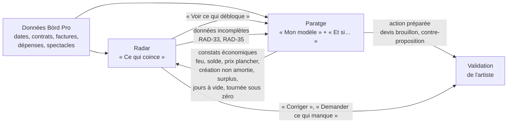

# Bòrd Pro — PARATGE, l'agent

**Spécification pour le développement · v1 · 12/11/2026**
Document jumeau : `02-RADAR-copilote.md`. Les deux remplacent la spécification commune v4 (`archives/02-SPEC-radar-paratge-developpeur.md`), dont ils reprennent toutes les décisions (D1 à D22).
Rappel `CLAUDE.md` §9 : plan validé avant toute modification de modèles, migrations, multi-tenant ou PDF.

---

## 0. En bref

**Paratge prépare ce qui débloque.** À partir du modèle économique de chaque spectacle, il dit ce que doit valoir une date (prix plancher, prix conseillé, cachet maximum), si elle tient (feu Saine / Juste / Perte), et ce qui peut la débloquer (« Et si… »). Il **prépare** les actions économiques (contre-proposition, devis brouillon) ; l'artiste valide toujours.

> « Paratge » lui va bien. Le mot vient du latin *pariatio*, « action de rendre égal ». Chez les troubadours, il désignait plus que l'honneur : il portait aussi une idée d'équilibre, d'ordre naturel et de ce qui est juste. C'est exactement ce que fait le module : vérifier qu'une date est juste et équilibrée, pour l'artiste comme pour l'organisateur.

| | Paratge |
| --- | --- |
| Rôle | Agent : calcule, simule, prépare |
| Question à laquelle il répond | « Combien vaut cette date, est-ce qu'elle tient, et qu'est-ce qui la ferait tenir ? » |
| Domaine | Modèle économique, financements, solde des dates et des tournées, leviers, actions économiques |
| Ce qu'il ne fait jamais | Envoyer quoi que ce soit, modifier un prix ou un document sans validation, calculer des charges sociales réelles, créer ses propres alertes |
| Offre (fait : catalogue Stripe du 11/11/2026) | **Collectif** (« Radar + Paratge à venir ») |
| À l'écran | « Mon modèle » · « Et si… » |
| Sources internes | Outil HTML `05-paratge-outil-modele-economique.html` et tableur `PARATGE - HopHopHop.xlsx` (10/11/2026, dossier DEV) : mêmes formules |

---

## 1. Rôle et limites

1. **Paratge prépare, l'artiste valide** (D17). Rien ne part vers un organisateur, rien ne change dans un devis ou un contrat sans un clic de l'artiste.
2. **Des repères, jamais des réalités** (D15). Les taux sont ajustables et affichés comme « repères » ; tout montant qui en dépend est marqué « estimation ».
3. **Pas de calcul de charges sociales réelles** (`CLAUDE.md` §10) : le coût de l'équipe est une estimation (cachet brut × (1 + taux repère)).
4. **Seuls les financements acquis comptent** (D20). Les autres n'apparaissent que dans les « Et si… ».
5. **Pas d'alertes à part** : Paratge fournit ses constats à Radar, qui les affiche (§9).
6. **Vocabulaire** : « solde prévisionnel », « solde réalisé », « prix plancher », « prix conseillé », « estimation », « repère », « fonds propres de la structure ». **Jamais** « bénéfice », « résultat », « marge » seule, « report à nouveau » seul.

**Règle de partage avec Radar :** Radar s'occupe de **ce qui est** (faits saisis, documents, échéances). Paratge s'occupe de **ce que vaut une date et de ce qui pourrait être**.

---

## 2. « Mon modèle » : la fiche économique d'un spectacle

| Bloc | Champs | Remarque |
| --- | --- | --- |
| Ce que paie le lieu | Prix de cession HT type, dates prévues sur la saison | Le prix réel de chaque date reste sur la date |
| Ce que coûte le plateau | Artistes payés, cachet brut par artiste, technique, route, **administratif / paie** (paies, contrats, DPAE, prestataire ou logiciel ; 0 si fait en interne), autres frais | Repris par défaut sur chaque nouvelle date, modifiables sur la date sans toucher au spectacle |
| La création | Coût de création / production | Dépensé avant la première date |
| Les financements | Liste (§3) | D20 |
| Le surplus | « Reporter sur les dates » · « Garder de côté » · « Décider plus tard » | D21, seulement s'il y a un surplus |

**Réglages repères de la structure (D15)**, communs à tous les spectacles : charges patronales 45 % (indice de base) · provision imprévus 5 % · marge de sécurité 10 % · commission de la structure **0 % pour un artiste seul, champ masqué** (le tableur HopHopHop utilise 10 % en exemple, pour une structure qui accompagne des projets).

---

## 3. Financements du spectacle (D20, D21)

| Champ | Valeurs |
| --- | --- |
| Type | Aide à la création · Aide à la tournée / diffusion · Mécénat · Apport en coproduction · Fonds propres de la structure (réserves, report à nouveau) · Autre |
| Montant | € |
| État | Envisagé · Demandé · **Acquis (notifié par écrit)** |
| Affectation | **Création** (réduit ce qui reste à amortir) · **Diffusion** (réduit le coût de chaque date) · **Une tournée** (réduit le solde de cette tournée, R1) |

- Seul l'état « Acquis » entre dans le calcul. Les autres sont additionnés dans « Financements en attente » et alimentent l'« Et si les financements en attente étaient acquis ? ».
- Surplus d'aide à la création (D21) : Paratge le signale (constat RAD-37, affiché par Radar) et propose trois choix ; tant que « Décider plus tard », il ne compte pas.
- Coproduction : seul l'apport en argent est compté ; un partage de recettes relève de la coréalisation, non gérée.
- Point à vérifier (D6, hypothèse) : certaines aides à la diffusion dépendent des dates réellement jouées et peuvent devoir être rendues si une date est annulée.

---

## 4. Formules — source unique de vérité

Une seule fonction, dans `apps/finance/services.py`, appartenant à Paratge. Radar, le bilan et tous les écrans la lisent. Montants en `Decimal`, au centime (F-58). Formules identiques à celles de l'outil HTML et du tableur HopHopHop.

### 4.1 Paramètres

| Symbole | Sens | Source |
| --- | --- | --- |
| P | Prix de cession HT de la date | `Gig` (ou prix testé dans « Et si… ») |
| n, cachet | Artistes payés, cachet brut par artiste | Mon modèle (ou équipe de la date) |
| t | Taux de charges (repère 0,45) | réglages |
| tech, route, admin, autres | Frais de la date | Mon modèle, puis dépenses prévues de la date |
| création | Coût de création | Mon modèle |
| aides_création, aides_diffusion | Financements **acquis** affectés à la création / à la diffusion | calculé (§3) |
| choix_surplus | D21 | Mon modèle |
| dates_prévues | Sur la saison | Mon modèle |
| k, r, m | Commission, provision imprévus, marge de sécurité | réglages |

### 4.2 Calculs

```
brut        = n × cachet
plateau     = brut × (1 + t)
coûts_date  = plateau + tech + route + admin + autres
à_amortir   = max(0, création − aides_création)
surplus     = max(0, aides_création − création)
amort       = à_amortir / max(1, dates_prévues)
soutien     = (aides_diffusion + (surplus si choix_surplus = « reporter sur les dates » sinon 0)) / max(1, dates_prévues)
direct      = max(0, coûts_date + amort − soutien)
reste_avant_création = P − coûts_date − r×P − k×P
solde_date  = reste_avant_création − amort + soutien     ← « solde prévisionnel »
prix_plancher  = direct / (1 − k − r)                    (« — » si 1 − k − r ≤ 0)
prix_conseillé = direct / (1 − k − r − m)                (« — » si ≤ 0)
cachet_max     = max(0, (P×(1 − k − r) − tech − route − admin − autres − amort + soutien) / (n × (1 + t)))
dates_pour_amortir = 0 si à_amortir = 0 ; ⌈à_amortir / reste_avant_création⌉ si reste_avant_création > 0 ; sinon « jamais à ce prix »
feu = « Perte » si solde_date < 0 ; « Juste » si P < prix_conseillé ; sinon « Saine »
```

### 4.3 Jeu de test de référence (test automatique)

Données : n = 4, cachet = 250 €, t = 0,45, tech = 300 €, route = 450 €, admin = 0 €, autres = 100 €, création = 6 000 €, dates prévues = 12, k = 0,10, r = 0,05, m = 0,10, P = 2 500 €.

| Cas | amort | soutien | solde_date | prix_plancher | prix_conseillé | cachet_max | feu |
| --- | --- | --- | --- | --- | --- | --- | --- |
| Aide de création de 2 000 € « demandée » (non comptée) | 500,00 | 0,00 | −675,00 | 3 294,12 | 3 733,33 | 133,62 | Perte |
| Même aide « acquise » | 333,33 | 0,00 | −508,33 | 3 098,04 | 3 511,11 | 162,36 | Perte |
| Aucune aide de création + aide à la tournée acquise de 1 200 € (diffusion) | 500,00 | 100,00 | −575,00 | 3 176,47 | 3 600,00 | 150,86 | Perte |
| Aides de création acquises de 8 000 € (surplus 2 000 €), « reporter sur les dates » | 0,00 | 166,67 | −8,33 | 2 509,80 | 2 844,44 | 248,56 | Perte |
| Même cas, « décider plus tard » | 0,00 | 0,00 | −175,00 | 2 705,88 | 3 066,67 | 219,83 | Perte |

### 4.4 Tournée (R1)

- Une tournée = un nom, **un spectacle** (D13), une date de début et une date de fin (D3) ; les dates du spectacle dans la période en font partie, sauf celles cochées « hors tournée » (D14).
- solde_tournée = Σ solde_date − dépenses communes non réparties + financements acquis affectés à cette tournée.
- Jours à vide = jours de la période sans date confirmée ni option ; coût = nb de jours × Σ dépenses de tournée cochées « par jour ».
- Prix minimum d'une date ajoutée un jour à vide = plateau + frais propres à la date.
- « Avant / après » à la signature = solde_tournée sans la date / avec la date.

---

## 5. « Et si… » : les leviers

Chaque constat économique a deux faces : **ce qui coince** (chiffré) et **ce qui peut débloquer** (leviers cochables, solde recalculé, fragment HTMX). Leviers :

- prix différent (contre-proposition) ;
- équipe réduite (décocher un membre ; ne modifie pas l'équipe réelle de la date) ;
- hébergement, repas ou transport pris en charge par l'organisateur ;
- option confirmée ;
- financement en attente obtenu ;
- jour à vide rempli (R1).

### Simulateur de contre-proposition (PI-3, R1)
Sur une date en option ou un devis : montant proposé → solde, prix plancher, prix conseillé, feu. Texte de réponse à partir d'un **modèle à trous, sans IA**, qui ne montre jamais les coûts internes sauf choix explicite de l'artiste. Boutons « Copier », « Ouvrir dans ma messagerie ». « Appliquer au devis » crée un **devis brouillon** ; rien d'autre n'est enregistré.

### Coût des jours à vide (PI-2, R1)
Calcul §4.4. Rien n'est affiché sans dépense « par jour ». Jours consécutifs regroupés.

---

## 6. Visuels de Paratge

| # | Visuel | Description | Jalon |
| --- | --- | --- | --- |
| — | Carte « ce qui coince / ce qui peut débloquer » | Constat chiffré + leviers cochables + verdict | V0 (sans leviers de tournée) |
| V1 | Ligne de flottaison de la tournée | Bande des jours (date, option, jour à vide) + solde cumulé autour de zéro ; « Et si l'option du … était confirmée ? » | R1 |
| V5 | Avant / après en image | Deux lignes de flottaison dans le pop-up de signature | R1 |
| V4 | Curseur de prix | Dans le simulateur : le prix glisse, le solde et la zone sous le plancher bougent | R1 |

SVG généré côté serveur, recalcul HTMX, pas de bibliothèque de graphiques ; jamais la couleur seule.

---

## 7. Données

| Objet | Existe ? | À faire pour Paratge |
| --- | --- | --- |
| Modèle du spectacle | En partie (`Show` : nombre d'artistes et techniciens) | cachet brut, technique, route, administratif / paie, autres frais, coût de création, dates prévues, choix du surplus |
| Financements du spectacle | Non | Nouveau `TenantOwnedModel` lié au spectacle : type, montant, état, affectation (création / diffusion ; tournée en R1). Test d'isolation |
| Réglages repères | Non | Sur `Tenant` : taux de charges, provision, marge, commission (masquée) |
| `Tour` (R1) | Non | Nom, spectacle (obligatoire), statut, début, fin |
| `Gig` (R1) | Oui | Case « hors tournée » |
| `Expense` (R1) | Oui | Phase prévu / réel (D9) ; lien optionnel vers `Tour` ; case « par jour » |
| Import du tableur / de l'outil HTML | — | Facultatif (D18) : utile pour les accompagnements HopHopHop |

---

## 8. Constats économiques fournis à Radar

Paratge calcule ; Radar affiche (même format, même écran « Ce qui coince »).

| ID | Constat | Grav. | Moment | Jalon |
| --- | --- | --- | --- | --- |
| RAD-30 | Feu « Perte » (solde_date < 0) | C | pop-up à la signature + pastille | V0 |
| RAD-31 | Feu « Juste » (P < prix conseillé) | S | pastille | V0 |
| RAD-33 | Cachets ou taux de charges non renseignés : solde incomplet | C | pastille | V0 |
| RAD-37 | Aides de création acquises > coût de création : « que faire du surplus ? » | S | pastille sur le spectacle | V0 |
| RAD-34 | Devis sous le prix plancher | C | pop-up à l'envoi du devis | R1 |
| RAD-32 | Dépenses réelles > prévues de plus de 15 % | C | pastille | R1 |
| RAD-36 | Création pas amortie : « il faut encore N dates à ce prix » | S | pastille sur le spectacle | R1 |
| RAD-40 | Signer ce contrat fait passer la tournée sous zéro (avant / après) | C | pop-up à la signature | R1 |
| RAD-41 | Solde de tournée négatif ; dates ou prix moyen manquants pour équilibrer | C | pastille | R1 |
| RAD-42 | Dépenses communes non réparties | S | pastille | R1 |
| RAD-45 | Jours à vide : leur coût et le prix minimum d'une date ajoutée | S | pastille | R1 |

---

## 9. Interconnexion Radar ↔ Paratge

*(Section identique dans les deux documents.)*

**La règle de partage :** Radar = **ce qui est** (faits, documents, logistique, échéances, obligations). Paratge = **ce que vaut une date et ce qui pourrait être** (modèle économique, financements, projections, leviers, actions économiques préparées).



| Point de contact | Règle |
| --- | --- |
| **Un seul système d'alertes** | Radar. Paratge ne crée pas d'alertes à part : il fournit des **constats économiques** que Radar affiche comme des règles (RAD-30 à 34, 36, 37, 40 à 42, 45), avec le même format, les mêmes pastilles et le même écran |
| **Une seule formule** | Elle appartient à Paratge (`apps/finance/services.py`). Radar, le bilan et tous les écrans la lisent ; personne ne la recopie |
| **Le pont vers Paratge** | Chaque alerte économique porte un bouton « Voir ce qui débloque » qui ouvre les « Et si… » de Paratge sur la date ou la tournée concernée |
| **Le pont vers Radar** | Paratge affiche les alertes Radar de complétude de la date (RAD-33, RAD-35…), car un calcul sur des données incomplètes est faux |
| **Un seul pop-up par action** | À la signature, la même modale montre les alertes Radar (documents, logistique) **et** l'« avant / après » de Paratge |
| **Validation** | Aucun des deux n'envoie ni ne modifie sans l'artiste : Radar oriente, Paratge prépare, l'artiste valide |
| **Offres** (fait : catalogue Stripe du 11/11/2026) | **Pilotage** : Radar seul. **Collectif** : Radar + Paratge |
| **Radar sans Paratge** (Pilotage, à valider) | Radar fonctionne seul avec ses règles A, B, C, D (RAD-29, 35), F, G. Les règles économiques RAD-30 et suivantes sont absentes. Sous RAD-29, une mention discrète indique que Paratge (offre Collectif) montre ce qui peut débloquer la date |
| **Version 0** | Construite et testée **ensemble** (les artistes testeurs ont Radar + Paratge) |

Données partagées :

| Objet | Radar | Paratge |
| --- | --- | --- |
| Date (`Gig`) | lit ; règles de complétude, échéances | lit ; solde, feu, prix plancher |
| Contrat, devis, facture | lit ; règles de documents | lit ; crée un **devis brouillon** sur validation (contre-proposition) |
| Spectacle (`Show`) | lit (durée, équipe) | lit et écrit « Mon modèle » et ses financements |
| Dépenses, paiements | lit (RAD-29, 50, 51, 53) | lit ; ajoute la phase prévu / réel et les dépenses communes de tournée (R1) |
| Tournée (`Tour`) | lit (synthèse partagée, R3) | crée et calcule (R1) |
| Alertes (`Alert`) | crée et gère | fournit les constats ; ne crée rien directement |

---

## 10. Feuille de route de Paratge

| Jalon | Contenu Paratge | Validation avant le suivant |
| --- | --- | --- |
| **V0** (avec Radar V0) | Mon modèle, réglages repères, financements (création, diffusion), choix du surplus ; feu, prix plancher, prix conseillé sur chaque date ; carte « ce qui coince / ce qui débloque » ; constats RAD-30, 31, 33, 37 | Jeu de test §4.3 vert ; test 3 à 4 semaines avec 2 ou 3 artistes |
| R1 · Paratge et tournée | Tournée par période, hors tournée, dépenses prévu / réel et communes, financements par tournée ; PI-2, PI-3 ; V1, V4, V5 ; constats RAD-32, 34, 36, 40 à 42, 45 | Formules vérifiées par l'associé sur des dates réelles |
| Après R2 · Structure (offre Collectif) | Charges fixes de la structure, commission, forfait annuel par projet, subvention de fonctionnement, fonds propres affectés au fonctionnement (D11, D22 ; onglet « Structure » du tableur) | — |

Tout démarre après la fin du MVP (D12).

---

## 11. À vérifier dans le code avant de commencer (pour Paratge)

1. Quels champs de `Show` existent déjà pour « Mon modèle » ?
2. `Expense` distingue-t-il déjà prévu et réel ? (D9)
3. Quels statuts de date existent (option, confirmée) ? Ils servent au solde de tournée et aux jours à vide.

## 12. Points à valider par le porteur du projet

- La ligne « administratif / paie » du tableur du 10/11 est reprise dans les frais de la date (non prévue dans la spécification v4).
- La commission reste à 0 % et masquée pour un artiste seul, même si le tableur montre 10 % en exemple.
- Les indicateurs « heures par artiste » et « part des 507 h » du tableur ne sont **pas** repris dans Paratge (la piste « cachets confiés à l'équipe » n'avait pas été retenue) : à confirmer.

## 13. Sources

- Tableur `PARATGE - HopHopHop.xlsx` (10/11/2026) et outil HTML Paratge (internes, HopHopHop).
- Catalogue Stripe du 11/11/2026 (document projet `claude/stripe-abonnements-bord-pro.md`).
- Spécification commune v4 du 08/11/2026 (`archives/`).
- Paratge, étymologie : https://kaikki.org/frwiktionary/All%20languages%20combined/meaning/p/pa/paratge.html
- Paratge chez les troubadours : https://www.midi-france.info/190403_paratge.htm
- Taux de charges (repère non officiel) : https://macalculatriceenligne.com/outils/calcul-cachet-intermittent/
