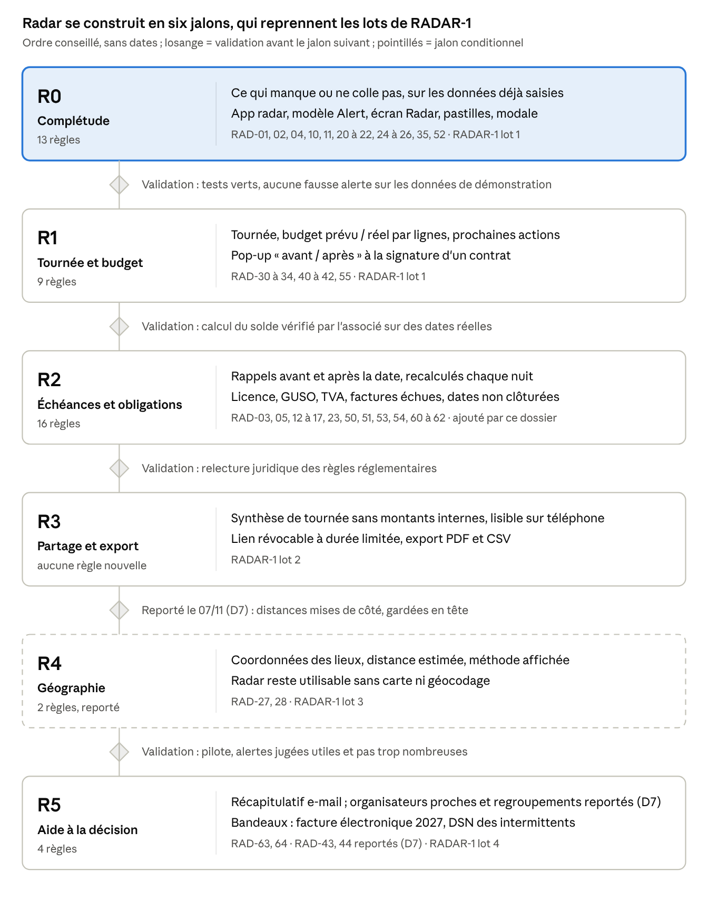

# Bòrd Pro — Radar : feuille de route et dossier de conception

Mis à jour le 08/11/2026 · Version de travail exportée du document Claude Docs : https://claude.ai/artifact/HMHv3yTrLpQogbDcsaANAU · Historique des réflexions. Les spécifications qui font foi pour le développement sont 02-RADAR-copilote.md et 03-PARATGE-agent.md (12/11/2026)

## En bref

Radar est le contrôleur intégré de Bòrd Pro : il relit en continu les dates, contrats, feuilles de route et budgets, et prévient l'artiste dès qu'une information manque, qu'un chiffre est incohérent ou qu'une décision fait perdre de l'argent. Il joue le rôle de l'administrateur de compagnie que les petites structures n'ont pas.

Recommandation : construire Radar en six jalons (R0 à R5) qui reprennent les quatre lots de RADAR-1. D'abord les **contrôles de complétude** (données déjà présentes, risque faible), puis la **tournée et son budget prévu / réel**, puis les **échéances et obligations**, le **partage**, la **géographie** (sous condition) et enfin l'**aide à la décision**. Chaque jalon est livrable seul.

Ce document sert de base au cahier des charges de Radar et aux échanges avec le développeur.

> **Confronté à RADAR-1 le 07/11/2026.** RADAR-1 décrit un « Radar de tournée » (tournée, budget prévu/réel, prochaines actions, géographie, partage). Ce dossier y ajoute la dimension « administrateur » (contrôles de documents, pop-up à la signature, rappels réglementaires). Les deux sont fusionnés ci-dessous ; la section suivante liste ce qui converge, ce qui a été ajouté et ce qui entre en conflit avec `CLAUDE.md`.

> **Point de vigilance :** `CLAUDE.md` classe Radar « après le MVP » et exclut le calcul de charges GUSO/intermittence. Radar peut **signaler** un risque social (ex. : n° GUSO manquant), mais ne doit pas **calculer** des charges tant que ce point n'est pas rouvert.

## Le nom du module : Paratge

> « Paratge » lui va bien. Le mot vient du latin *pariatio*, « action de rendre égal ». Chez les troubadours, il désignait plus que l'honneur : il portait aussi une idée d'équilibre, d'ordre naturel et de ce qui est juste. C'est exactement ce que fait le module : vérifier qu'une date est juste et équilibrée, pour l'artiste comme pour l'organisateur.

Décidé le 07/11/2026 : Radar (les alertes) et l'outil Paratge (ex-Partatge, le modèle économique d'une cession) forment ensemble le module **Paratge**. À l'écran : « Mon modèle », « Ce qui coince » (moteur Radar), « Et si… ». La spécification consolidée pour le développeur est dans le projet (`claude/spec-radar-paratge-developpeur.md`) et dans le dossier DEV › radar. Sources : [étymologie](https://kaikki.org/frwiktionary/All%20languages%20combined/meaning/p/pa/paratge.html), [sens chez les troubadours](https://www.midi-france.info/190403_paratge.htm).

## Confrontation avec RADAR-1

RADAR-1 et ce dossier vont dans le même sens : alertes explicables, sans IA, prévu et réel séparés, l'utilisateur décide. Six points de RADAR-1 contredisent `CLAUDE.md` et doivent être tranchés avant de coder.

### Ce que RADAR-1 apporte et qui est repris

| Apport de RADAR-1 | Où il est repris |
| --- | --- |
| La **tournée** comme objet, avec ses dates triées et ses totaux | Jalon R1, modèle `Tour` (voir Éléments techniques) |
| **Prochaine action** par date (relancer, confirmer, demander une info) avec échéance | Jalon R1, champs sur `Gig` |
| Budget par **lignes** prévu / réel, « solde prévisionnel » et « solde réalisé », jamais présentés comme bénéfice | Jalon R1, règles RAD-30 à 34 et 40 à 42 ; vocabulaire des messages corrigé |
| Alertes : date passée non clôturée, option échue, montant non renseigné, ville manquante, distance, dates rapprochées | Famille H (9 règles ajoutées) |
| Alerte « traitée » ou « ignorée » par l'utilisateur | Règles d'interface |
| **Synthèse partageable** sans les montants internes, lien révocable à durée limitée, export PDF et CSV | Jalon R3 |
| Géocodage, distances étiquetées « estimation », fournisseur interchangeable, Radar utilisable sans carte | Jalon R4, **sous réserve de la décision D7** |
| Organisateurs de la base proches des villes de la tournée, dates à regrouper | Jalon R5 |
| Indicateurs de pilote (alertes traitées / ignorées, part des dates avec prochaine action…) | À mesurer dès R0 (critère de validation des jalons) |

### Ce que ce dossier ajoute à RADAR-1

- Contrôles de **documents** avant envoi ou signature (contrat, devis, facture, feuille de route) : familles A, B, C.
- **Pop-up à l'action engageante** avec « avant / après » chiffré (RAD-30, RAD-40). RADAR-1 ne prévoit que des alertes consultables.
- Rappels **réglementaires** (licence, GUSO, DSN, TVA, facture électronique) : famille G.

### Conflits avec `CLAUDE.md` à trancher

| # | RADAR-1 dit | `CLAUDE.md` dit | Proposition |
| --- | --- | --- | --- |
| C1 | Distances estimées, temps de trajet « potentiellement contraint », carte facultative | Hors périmètre : carte interactive, itinéraires calculés, temps de trajet ; Google Maps interdit ; aperçu OpenStreetMap autorisé | Décision D7. Option simple : distance **à vol d'oiseau** à partir de coordonnées saisies ou géocodées, sans temps de trajet. Exige de rouvrir §10 |
| C2 | Utilisable « sur ordinateur comme sur téléphone », vue liste mobile | Écrans connectés conçus pour l'ordinateur ; seules les pages publiques sont lisibles à 375 px | Radar sur ordinateur ; la **synthèse partagée** (page publique) lisible sur téléphone, comme la feuille de route |
| C3 | Tournée rattachée à une **version** de spectacle (distribution, besoins techniques) | Hiérarchie Projet/Spectacle hors MVP tant que non confirmée (Q1-Q16) | Pas de version au départ ; la tournée pointe vers un `Show` |
| C4 | Recettes de **coréalisation** | Coréalisation non gérée | Lignes de recettes libres « autres recettes », sans calcul de partage de recette |
| C5 | « API interne » pour les agrégats de tournée | DRF / API REST interdits | Fonctions de service (`services.py`) et fragments HTMX, pas d'API |
| C6 | Journaliser les changements de dates, montants et statuts | Rien de prévu | Nouveau besoin : à confirmer, et à garder minimal (qui, quand, ancien → nouveau) |

**À corriger dans RADAR-1 (forme) :** le produit y est nommé « Scènsemble » (ancien nom) et « BÒRD PRO » en capitales ; la charte impose « Bòrd Pro ».

## Principes produit (à reprendre tels quels dans le cahier des charges)

1. **Radar conseille, l'artiste décide.** Aucune alerte ne bloque une action (décision D5). Les cas graves (ex. : émettre une facture sans SIRET) demandent une confirmation explicite. L'utilisateur peut toujours « passer outre » en un clic, et ce choix est mémorisé.
2. **Chaque alerte dit quoi faire.** Format fixe : *ce qui ne va pas* → *pourquoi c'est important* → *un bouton qui mène au bon champ*. Jamais d'alerte sans action proposée.
3. **Le pop-up est rare.** On n'interrompt l'utilisateur qu'au moment d'une décision engageante (signer un contrat, émettre une facture, envoyer une feuille de route). Le reste du temps, Radar s'exprime par des pastilles discrètes et un écran « Radar » récapitulatif. Trop d'alertes = alertes ignorées.
4. **Trois niveaux de gravité, pas plus :** *Important (rouge, confirmation explicite demandé*e), *À corriger* (orange, risque réel), *À savoir* (gris/bleu, conseil). Les couleurs suivent la charte : couleurs d'état jamais décoratives.
5. **Vocabulaire du métier.** « Solde prévisionnel de cette date : −320 € » plutôt que « marge négative ». Jamais « bénéfice » ni « résultat » : ce n'est pas un résultat comptable (RADAR-1, §4.3). Pas de « écriture », « tiers », « entité ».
6. **Radar calcule à partir de ce qui est saisi, et le dit.** Une alerte de rentabilité affiche toujours les montants pris en compte, pour que l'artiste comprenne et corrige.
7. **Règles lisibles et testables.** Chaque règle a un identifiant (`RAD-xx`), une condition écrite en français, un message, un niveau, et au moins un test automatique.
8. **Isolation des tenants.** Les alertes sont des données du tenant comme les autres (règle 6.1 de `CLAUDE.md`).

## Catalogue des règles Radar

45 règles en 8 familles, chacune rattachée à un jalon de la feuille de route fusionnée avec RADAR-1. La famille H regroupe les règles issues de RADAR-1. Les données citées existent déjà dans l'app, sauf mention « nouveau champ ». **Gravité** : B = Important (confirmation explicite), C = À corriger, S = À savoir. **Moment** : *pop-up* = au clic sur une action engageante ; *pastille* = affiché sur la fiche et dans l'écran Radar ; *échéance* = calculé chaque nuit.

### A. Ma structure (Tenant)

| ID | Condition (en français) | Grav. | Moment | Données | Jalon |
| --- | --- | --- | --- | --- | --- |
| RAD-01 | SIRET, adresse ou nom légal absent au moment d'émettre un devis, une facture ou un contrat | B | pop-up | `Tenant` | R0 |
| RAD-02 | IBAN/BIC absent à l'émission d'une facture | C | pop-up | `Tenant` | R0 |
| RAD-03 | Plus de 6 représentations confirmées sur l'année civile et aucun n° de récépissé d'entrepreneur de spectacles saisi | C | pastille + pop-up à la 7e date | `Gig` (statut, date), nouveau champ `Tenant.licence_number` | R2 |
| RAD-04 | Régime TVA non renseigné (franchise ou assujetti) : la mention « TVA non applicable, art. 293 B du CGI » ne peut pas être décidée | C | pop-up à la 1re facture | nouveau champ `Tenant.vat_regime` | R0 |
| RAD-05 | En franchise de TVA : chiffre facturé de l'année ≥ 80 % du seuil applicable | S | échéance | `Invoice` | R2 |

### B. Contrat de cession

| ID | Condition | Grav. | Moment | Données | Jalon |
| --- | --- | --- | --- | --- | --- |
| RAD-10 | Champ obligatoire du contrat vide (organisateur : nom, SIRET, adresse, signataire ; lieu ; date et heure ; prix ; modalités de paiement) au passage « envoyé » ou « signé » | B | pop-up | `Contract`, `Promoter`, `Venue`, `Gig` | R0 |
| RAD-11 | La date, le lieu ou le prix du contrat diffèrent de ceux de la date (`Gig`) ou du devis accepté | C | pastille + pop-up à la signature | `Contract`, `Gig`, `Quote` | R0 |
| RAD-12 | Contrat toujours non signé à J-30 (délai réglable) | C | échéance | `Contract.status` | R2 |
| RAD-13 | Organisateur sans n° de licence ni mention « organisateur occasionnel » | S | pastille | nouveau champ `Promoter.licence_number` | R2 |
| RAD-14 | Contrat signé, date passée, aucune facture émise | C | échéance | `Contract`, `Invoice` | R2 |
| RAD-15 | Acompte prévu au contrat non reçu à l'échéance prévue | C | échéance | `Contract` (à valider : champ acompte), `Payment` | R2 |

### C. Feuille de route

| ID | Condition | Grav. | Moment | Données | Jalon |
| --- | --- | --- | --- | --- | --- |
| RAD-20 | À J-7 : il manque l'adresse, l'heure d'arrivée, l'heure de balances, l'heure du concert ou un contact sur place | C | échéance + pop-up au partage | `Roadmap`, `RoadmapSlot`, `Contact` | R0 |
| RAD-21 | Fin de date après minuit et aucun hébergement saisi | S | pastille | `Roadmap`, `Lodging` (sans calcul d'itinéraire) | R0 |
| RAD-22 | Horaires incohérents : balances après le concert, créneaux qui se chevauchent, créneau plus court que la durée du spectacle | C | pastille + pop-up au partage | `RoadmapSlot`, `Show` (durée, durée de balances) | R0 |
| RAD-23 | Feuille de route non partagée à l'équipe à J-3 | S | échéance | lien secret, `GigMember` | R2 |
| RAD-24 | Un membre de l'équipe est prévu sur deux dates le même jour | C | pastille | `GigMember`, `Gig` | R0 |
| RAD-25 | Nombre de personnes dans l'équipe de la date inférieur au nombre d'artistes et techniciens du spectacle | S | pastille | `GigMember`, `Show` | R0 |

### D. Rentabilité d'une date

| ID | Condition | Grav. | Moment | Données | Jalon |
| --- | --- | --- | --- | --- | --- |
| RAD-30 | Solde prévisionnel de la date < 0 (recettes prévues − dépenses prévues − coût équipe saisi) | C | pop-up à la signature + pastille | `Gig`, lignes de budget prévues, coût équipe | R1 |
| RAD-31 | Solde prévisionnel positif mais sous le seuil choisi par la structure (ex. 10 % des recettes) | S | pastille | idem + réglage `Tenant` | R1 |
| RAD-32 | Dépenses réelles supérieures de plus de 15 % aux dépenses prévues (seuil réglable) | C | pastille | lignes de budget (prévu / réel) | R1 |
| RAD-33 | Le spectacle compte des artistes ou techniciens, mais aucun cachet n'est saisi, ou le coefficient de la structure n'est pas choisi : le solde affiché est incomplet | C | pastille | `Show`, coût équipe | R1 |
| RAD-34 | Prix proposé dans un devis inférieur au « prix plancher » du spectacle (coût d'une date type) | C | pop-up à l'envoi du devis | `Quote`, nouveau champ `Show.floor_price` | R1 |

### E. Rentabilité d'une tournée

| ID | Condition | Grav. | Moment | Données | Jalon |
| --- | --- | --- | --- | --- | --- |
| RAD-40 | Signer ce contrat fait passer le solde prévisionnel de la tournée sous zéro (affiche « avant / après ») | C | pop-up à la signature | `Tour`, lignes de budget, dépenses communes | R1 |
| RAD-41 | Solde prévisionnel de la tournée négatif ; Radar indique combien de dates ou quel prix moyen il manque pour équilibrer | C | pastille sur la tournée | idem | R1 |
| RAD-42 | Dépenses communes (location de véhicule, création, répétitions) saisies sans être réparties sur les dates | S | pastille | lignes de budget de la tournée | R1 |
| RAD-45 | Jours à vide dans la période de tournée : leur coût et le prix minimum d'une date ajoutée (piste PI-2) | S | pastille sur la tournée | `Tour`, dépenses « par jour », cachets | R1 |

### F. Argent et échéances

| ID | Condition | Grav. | Moment | Données | Jalon |
| --- | --- | --- | --- | --- | --- |
| RAD-50 | Facture échue et non payée (encaissé < facturé après la date d'échéance) | C | échéance | `Invoice`, `Payment` | R2 |
| RAD-51 | Date passée depuis 30 jours, encaissé ≠ prévu | C | échéance | les trois montants (F-57) | R2 |
| RAD-52 | Facture sans date d'échéance, ou échéance au-delà du délai légal (à valider par la relecture juridique) | C | pop-up à l'émission | `Invoice` | R0 |
| RAD-53 | Dépense de l'équipe déclarée (espace personnel) en attente de validation depuis plus de 7 jours | S | échéance | `Expense` | R2 |

### G. Social et réglementaire (Radar signale, il ne calcule pas)

| ID | Condition | Grav. | Moment | Données | Jalon |
| --- | --- | --- | --- | --- | --- |
| RAD-60 | Date confirmée avec des salariés : rappel de faire la déclaration préalable à l'embauche avant la date | S | échéance | `GigMember` + case « fait » (nouveau champ) | R2 |
| RAD-61 | Structure déclarant au GUSO : déclaration et paiement non cochés 15 jours après la fin du contrat | C | échéance | réglage `Tenant.social_mode`, case « fait » | R2 |
| RAD-62 | Membre d'équipe sans n° GUSO / n° de sécurité sociale avant la date (visible du propriétaire seul) | C | échéance | fiche Équipe | R2 |
| RAD-63 | Facturation électronique : les factures PDF actuelles ne suffiront plus pour un organisateur professionnel à partir du 1er septembre 2027 | S | bandeau d'information | aucune | R5 |
| RAD-64 | Déclaration sociale des intermittents en DSN (bascule progressive jusqu'à fin mars 2027) : rappel d'information pour les structures concernées | S | bandeau d'information | réglage `Tenant.social_mode` | R5 |

### H. Règles issues de RADAR-1

| ID | Condition | Grav. | Moment | Données | Jalon |
| --- | --- | --- | --- | --- | --- |
| RAD-26 | Date sans ville ni adresse : elle reste consultable, Radar signale le manque | C | pastille | `Gig`, `Venue` | R0 |
| RAD-35 | Prix de cession ou frais non renseignés : le solde affiché est incomplet | C | pastille | `Gig`, lignes de budget | R0 |
| RAD-55 | Prochaine action dont l'échéance est dépassée | C | échéance | nouveaux champs `Gig.next_action`, `Gig.next_action_date` | R1 |
| RAD-16 | Option posée dont l'échéance est dépassée, ou date sans statut clair | C | échéance | `Gig.status`, nouveau champ `Gig.option_expires_on` | R2 |
| RAD-17 | Date confirmée et contrat toujours non envoyé après X jours (réglable) | C | échéance | `Contract.status` (à vérifier : le statut « envoyé » existe-t-il ?) | R2 |
| RAD-54 | Date passée sans clôture (jouée, annulée…) | C | échéance | `Gig.status` | R2 |
| RAD-27 | Distance entre deux dates consécutives supérieure au seuil choisi (distance estimée, méthode affichée) | S | pastille | coordonnées, réglage `Tour` | R4 |
| RAD-28 | Deux dates rapprochées et éloignées : « point à vérifier », jamais une validation de faisabilité ou de sécurité | S | pastille | idem | R4 |
| RAD-43 | Organisateurs de la base situés près des villes de la tournée (aide à la recherche, aucun envoi automatique) | S | écran tournée | `Promoter`, coordonnées | R5 |
| RAD-44 | Dates proches à regrouper, ou zone où une date en plus réduirait les kilomètres à vide | S | écran tournée | coordonnées | R5 |

Toutes les règles du groupe G et RAD-03, RAD-05, RAD-13, RAD-52 sont à faire relire par un juriste ou un administrateur de production avant mise en ligne.

## Comportement à l'écran

Radar s'exprime à trois endroits, du plus discret au plus insistant. Le pop-up est réservé aux actions engageantes.

| Endroit | Quand | Ce que voit l'artiste | Règles concernées |
| --- | --- | --- | --- |
| **Pastille** sur une fiche (date, contrat, feuille de route) et dans la liste des dates | En permanence | Un rond de couleur + un nombre (« 2 à corriger »). Au clic : la liste des alertes de cette fiche | Toutes |
| **Écran « Radar »** (entrée dans le menu, compteur) | En permanence | Toutes les alertes ouvertes, triées par gravité puis par date la plus proche ; filtres par famille | Toutes |
| **Pop-up** (modale) | Au clic sur : signer un contrat, émettre une facture, envoyer un devis, partager une feuille de route, confirmer une date | Les seules alertes liées à cette action, avec les montants pris en compte. Boutons : « Corriger » (mène au champ) et « Continuer quand même » (sauf Bloquant) | Règles marquées pop-up |
| **E-mail récapitulatif** (optionnel, R4) | Une fois par semaine | Les alertes à corriger dans les 14 prochains jours | Échéances |

### Exemple de pop-up (RAD-40)

> **Cette date rend la tournée « Printemps 2027 » déficitaire.** Solde prévisionnel de la tournée : +450 € avant ce contrat → −180 € après. Pris en compte : cession 1 200 € ; dépenses prévues 980 € ; coût équipe 850 €. Pour garder la tournée à l'équilibre : prix de cession minimum 1 380 €, ou 180 € de dépenses en moins. Pour que cette date soit elle-même à l'équilibre : 1 830 €. \[Modifier le prix\] \[Voir le budget\] \[Signer quand même\]

*Montants fictifs, pour illustrer le format.*

### Règles d'interface

- Une alerte « ignorée » disparaît de la pastille mais reste dans l'écran Radar (filtre « ignorées ») ; elle revient si les données changent.
- Une alerte se ferme toute seule quand la condition n'est plus vraie. L'utilisateur peut aussi la marquer « traitée » (indispensable pour les tâches hors de l'app : déclaration GUSO, DPAE, relance téléphonique) ou « ignorée » (RADAR-1, §4.2).
- Jamais plus d'un pop-up par action. S'il y a plusieurs alertes, elles sont listées dans la même modale.
- La modale est un composant Alpine.js dans `templates/components/` ; son contenu est un fragment HTMX.

## Éléments techniques pour le développeur

Proposition la plus simple compatible avec la stack imposée (Django, HTMX, Alpine, pas de Celery/Redis). **Tout ce qui touche aux modèles et migrations doit passer par un plan validé avant de coder (règle 9 de `CLAUDE.md`).**

### Où mettre Radar

`CLAUDE.md` interdit de créer une app sans en parler. Deux options :

| Option | Avantage | Inconvénient |
| --- | --- | --- |
| **1. Nouvelle app `apps/radar/`** (recommandée) | Un domaine = une app ; les règles, le modèle d'alerte et l'écran Radar sont au même endroit | Demande l'accord explicite (nouvelle app) |
| 2. Un module `radar.py` dans chaque app (`documents/radar.py`, `roadmaps/radar.py`…) + affichage dans `core` | Pas de nouvelle app | Règles éparpillées, écran Radar sans domicile clair |

### Fonctionnement (sans tâche de fond)

1. **Une règle = une fonction** dans `apps/radar/rules/<famille>.py`, par exemple `def rad_30_gig_loss(gig) -> Finding | None`. Elle lit les données et renvoie soit rien, soit un constat (code, gravité, message, lien vers le champ, montants pris en compte).
2. **Un registre** (`rules/__init__.py`) liste les règles par objet concerné (`Gig`, `Contract`, `Roadmap`, `Invoice`, `Tenant`) et par action (`sign_contract`, `issue_invoice`, `send_quote`, `share_roadmap`, `confirm_gig`).
3. **Trois déclencheurs** :
   - *À l'action* : la vue appelle `radar.check(action, obj)` avant d'exécuter ; si des constats existent, elle renvoie le fragment de la modale au lieu d'agir.
   - *À l'enregistrement* : après chaque sauvegarde d'un objet, `radar.refresh(obj)` recalcule les règles de cet objet et des objets liés (la date, la tournée). Appel explicite dans le service, **pas de signal Django** (plus lisible pour un débutant).
   - *Chaque nuit* : une commande `python manage.py radar_daily` (planifiée par le planificateur de Scalingo) recalcule les règles d'échéance (J-30, J-7, factures échues). Pas de Celery.
4. **Stockage** : un modèle `Alert(TenantOwnedModel)` avec `rule_code`, `severity` (TextChoices), lien générique vers l'objet (ou FK nullable vers `Gig`, plus simple), `message`, `data` (JSON des montants pris en compte), `status` (ouverte, ignorée, traitée, fermée), `first_seen`, `last_seen`, `dismissed_by`. Contrainte d'unicité `(tenant, rule_code, objet)` pour ne jamais dupliquer une alerte.
5. **Réglages par structure** : seuil de marge, délais (J-30, J-7), règles désactivées. Quelques champs sur `Tenant` ou un petit modèle `RadarSettings`.

### Modèle de données : RADAR-1 face à l'existant

RADAR-1 demande de réutiliser les objets existants. Appliqué à Bòrd Pro, il faut **un seul nouveau modèle métier (`Tour`)**, un modèle technique (`Alert`) et quelques champs. Tout passe par un plan validé avant migration.

| RADAR-1 propose | Existe dans Bòrd Pro | Recommandation |
| --- | --- | --- |
| `Tournee` (nom, spectacle, version, dates, statut, devise, seuil de distance) | Non | Nouveau modèle `Tour(TenantOwnedModel)` : nom, `show` (FK, à confirmer), statut, date de début et date de fin **saisies** : elles définissent la tournée (D3). Pas de version (conflit C3), pas de devise (euro seul, comme le reste de l'app) |
| `DateEvenement` | Oui : `Gig` | Pas de lien direct vers la tournée (D3 : une date en fait partie par son jour). Ajouter `next_action`, `next_action_date`, `option_expires_on`. Adresse : celle du `Venue`, pas de copie |
| Latitude, longitude avec provenance et date de géocodage | Non | Reporté (D7). Le jour venu : sur `Venue` (le lieu ne bouge pas d'une date à l'autre) |
| `LigneBudgetDate` (nature recette/dépense, phase prévu/réel, catégorie, justificatif, auteur) | En partie : `Expense` (argent dépensé), `Payment` (argent reçu), prix du `Gig` | À trancher (D9). Option simple : ajouter `phase` (prévu / réel) à `Expense` ; recettes prévues = prix de cession + champ « autres recettes prévues » ; recettes réalisées = `Payment`. On garde les trois montants distincts (F-57) |
| Dépenses communes à la tournée | Non | `Expense` avec `tour` (FK nullable) et sans `gig` ; répartition calculée, jamais stockée |
| `Alerte / Action` (type, règle, priorité, statut ouverte/ignorée/traitée, action suggérée, échéance, assigné à) | Non | Modèle `Alert` décrit plus haut, statuts : ouverte, ignorée, traitée, fermée. « Assigné à » : plus tard, si plusieurs membres travaillent sur une même structure |
| Distances | Non | **Jamais stockées comme vérité.** Calculées à l'affichage ; si mises en cache, avec méthode, fournisseur, date et unité (RADAR-1, §6) |
| Lien de partage de la synthèse, révocable, à durée limitée | Oui pour la feuille de route (`secrets.token_urlsafe(32)`, révocable) | Réutiliser le même mécanisme pour la synthèse de tournée ; ajouter une date d'expiration (à vérifier : existe-t-elle déjà pour la feuille de route ?) |

**Calcul des agrégats de tournée** (RADAR-1 demande « sans requêtes lourdes répétées ») : une fonction `tour_totals(tour)` dans `apps/finance/services.py`, qui fait une seule requête agrégée (`aggregate`/`annotate`), réutilisée par l'écran Radar, la synthèse et les règles RAD-40 à 42. Pas d'API (conflit C5).

### Calcul du solde d'une date (R1)

```latex
\text{Solde prévisionnel} = \text{Recettes prévues (cession HT + autres)} - \text{Dépenses prévues} - \text{Coût équipe saisi} - \text{Part des dépenses communes}
```

- Tous les montants en `Decimal`, au centime (règle F-58) ; on ne mélange jamais prévu, facturé et encaissé (F-57).
- Le **coût équipe** est un montant saisi par l'artiste (coût employeur total de la date). Radar **ne calcule pas les charges sociales** : c'est hors périmètre (`CLAUDE.md` §10). Un lien vers le simulateur officiel du GUSO peut aider l'artiste à trouver le chiffre.
- La fonction de calcul vit dans `apps/finance/services.py` (elle sert aussi au bilan) ; Radar ne fait que la lire.

### Tests (définition de « terminé » pour chaque règle)

- Un test qui déclenche la règle, un test qui ne la déclenche pas, un test à la limite (ex. résultat = 0 €).
- Un test d'isolation : les alertes du tenant A n'apparaissent jamais chez B (404 et listes vides), comme exigé par `test_tenant_coverage.py`.
- Un test de vue par action engageante : la modale s'affiche, « Continuer quand même » exécute l'action, « Bloquant » l'empêche.
- Les messages sont relus contre le lexique (pas de « tiers », « entité », « Structure » pour l'organisateur).

### Ce que le développeur doit recevoir avant de commencer

- [ ] Ce document validé (RADAR-1 intégré le 07/11) ; `specification-radar.md` du dépôt à confronter seulement si elle diffère de RADAR-1
- [ ] Accord sur l'option d'emplacement (app `radar` ou non)
- [ ] Liste des champs obligatoires du contrat de cession, modèle par modèle (les quatre modèles)
- [ ] Décisions D7 (distances) et D9 (lignes de budget), nécessaires à R1 et R4
- [ ] Textes des messages validés pour les règles du jalon en cours
- [ ] Jeu de données `seed_demo` enrichi avec une date déficitaire, un contrat incomplet et une feuille de route incohérente

## Feuille de route

R0 d'abord : il n'utilise que des données déjà saisies et pose tout le socle (modèle d'alerte, écran, modale). R1 et R0 forment ensemble le « lot 1 » de RADAR-1. R2 est l'apport propre de ce dossier. R4 ne démarre que si la décision D7 lève l'exclusion des distances dans `CLAUDE.md`.



| Jalon | Contenu | Règles et pistes | Validation avant le jalon suivant |
| --- | --- | --- | --- |
| R0 Complétude | Ce qui manque ou ne colle pas ; socle Radar + « Demander ce qui manque » et « Pourquoi ? » | RAD-01, 02, 04, 10, 11, 20 à 22, 24 à 26, 35, 52 · PI-1, PI-4 (RADAR-1 lot 1) | Tests verts, aucune fausse alerte sur les données de démonstration |
| R1 Tournée et budget | Tournée, budget prévu / réel, prochaines actions ; pop-up « avant / après », jours à vide, contre-proposition | RAD-30 à 34, 40 à 42, 45, 55 · PI-2, PI-3 (RADAR-1 lot 1) | Calcul du solde vérifié par l'associé sur des dates réelles |
| R2 Échéances et obligations | Rappels recalculés chaque nuit ; licence, GUSO, TVA, factures échues, dates non clôturées | RAD-03, 05, 12 à 17, 23, 50, 51, 53, 54, 60 à 62 | Relecture par un administrateur de production |
| R3 Partage et export | Synthèse sans montants internes, lisible sur téléphone ; lien révocable, PDF, CSV | — (RADAR-1 lot 2) | Reporté le 07/11 (D7) : distances mises de côté |
| R4 Géographie (reporté) | Coordonnées des lieux, distance estimée ; Radar utilisable sans carte | RAD-27, 28 (RADAR-1 lot 3) | Pilote : alertes jugées utiles et pas trop nombreuses |
| R5 Aide à la décision | Récapitulatif e-mail ; bandeaux facture électronique 2027 et DSN | RAD-63, 64 ; RAD-43, 44 reportés (RADAR-1 lot 4) | — |

**Prérequis avant R0** : `CLAUDE.md` place Radar après le MVP. Les chantiers ouverts (e-mails Brevo, domaine, S3, Sentry, sauvegardes, relecture des contrats) passent avant. Le récapitulatif par e-mail de R5 dépend de Brevo.

**Une PR par règle ou petit groupe de règles** (`feature/radar-rad-30`), conformément à la méthode de travail du dépôt. Les jalons R1, R2 et R4 demandent de nouveaux champs : plan validé avant chaque migration.

## Pistes innovantes retenues

Quatre fonctions retenues le 07/11/2026, absentes des sources consultées sur la concurrence. Deux s'ajoutent à R0, deux à R1. Aucune ne dépend des distances (D7), aucune n'envoie quoi que ce soit sans validation de l'artiste.

| ID | Piste | Jalon | Effort estimé | Nouveauté dans le code |
| --- | --- | --- | --- | --- |
| PI-1 | « Demander ce qui manque » en un clic | R0 | Faible | Réutilise le formulaire de complétion organisateur existant |
| PI-4 | « Pourquoi cette alerte ? » | R0 | Faible | Textes dans le registre des règles, aucun modèle |
| PI-2 | Coût des jours à vide | R1 | Moyen | Un champ « par jour » sur les dépenses de tournée |
| PI-3 | Simulateur de contre-proposition | R1 | Moyen | Un écran de calcul, rien n'est enregistré par défaut |

### PI-1 · « Demander ce qui manque » en un clic (R0)

**Objectif :** transformer une alerte en action. Quand l'information manquante doit venir de l'organisateur, Radar propose de la lui demander directement.

**Comportement :**

1. Sur une alerte éligible, un bouton « Demander à l'organisateur ».
2. Il crée le lien de complétion déjà prévu par `CLAUDE.md` §6.3 (lien secret de 7 jours, à usage unique), avec **uniquement les champs manquants**.
3. L'artiste copie le lien ou ouvre un e-mail pré-rempli (`mailto:`) : aucun envoi automatique.
4. L'alerte passe à « demandé le JJ/MM » (nouveau statut d'alerte « en attente »).
5. Les réponses sont vérifiées par l'artiste avant d'être appliquées (règle existante). L'alerte se ferme d'elle-même ensuite.
6. Lien expiré sans réponse : l'alerte revient en « à corriger » avec « relancer ».

**Alertes éligibles :** RAD-10 (champs organisateur du contrat), RAD-20 (horaires, contact sur place), RAD-26 (adresse du lieu). Jamais pour les informations de ta structure.

**Critères d'acceptation :**

- [ ] Le formulaire ne montre que les champs listés dans l'alerte.
- [ ] Un organisateur ne peut voir aucune autre donnée que ces champs (test d'isolation).
- [ ] Rien n'est modifié tant que l'artiste n'a pas validé.
- [ ] Le bouton n'apparaît pas si aucun champ manquant n'est dans le périmètre du formulaire.

**À vérifier dans le code :** le formulaire de complétion actuel accepte-t-il une liste de champs variable ?

### PI-4 · « Pourquoi cette alerte ? » (R0)

**Objectif :** que Radar forme l'artiste au lieu de seulement le prévenir, et inspire confiance.

**Comportement :** sous chaque alerte, un lien « Pourquoi ? » déplie trois éléments (petit état Alpine.js) :

- **L'explication**, en deux phrases maximum, dans le vocabulaire du métier.
- **Ce que ferait un administrateur** dans ce cas, en une phrase.
- **La source officielle**, avec la date de vérification (« vérifié le 07/11/2026 »). Uniquement des sites officiels ou de référence : guso.fr, francetravail.fr, culture.gouv.fr, impots.gouv.fr, service-public.fr, artcena.fr.

**Exemple (RAD-03) :**

> **Pourquoi ?** Au-delà de 6 représentations par an, l'activité d'entrepreneur de spectacles doit être déclarée. Votre 7e date de l'année est confirmée et aucun récépissé n'est enregistré. **Ce que ferait un administrateur :** il déclare l'activité sur la plateforme PLATESV avant de confirmer la date. **Source :** ministère de la Culture, fiche 4.2 PLATESV — vérifié le 07/11/2026.

*Texte à faire relire par l'administrateur de production (D6).*

**Données :** trois textes et une URL par règle, dans le registre des règles (code), pas en base.

**Critères d'acceptation :**

- [ ] Les 13 règles de R0 ont leur « Pourquoi ? ».
- [ ] Règle de livraison : **une règle réglementaire sans source officielle n'est pas mise en ligne.**
- [ ] Un test vérifie que chaque règle du registre a ses trois textes.

### PI-2 · Coût des jours à vide (R1)

**Objectif :** montrer ce que coûtent les jours sans date d'une tournée, et à partir de quel prix une date ajoutée ce jour-là couvre ses propres frais.

**Prérequis :** la tournée est une période (D3). Un jour à vide = un jour de la période sans date confirmée ni option.

**Calcul (côté serveur, au centime) :**

```latex
\text{Coût des jours à vide} = \text{Nombre de jours à vide} \times \text{Coût journalier de la tournée}
```

- Le **coût journalier** = somme des dépenses de la tournée marquées « par jour » (hébergement, défraiements, location du véhicule). Nouveau champ : case « dépense par jour » sur une dépense de tournée.
- Le **prix minimum d'une date ajoutée** = coût équipe estimé de la date (cachets bruts × 1,45) + frais propres à la date. Les coûts journaliers sont déjà dépensés, ils ne comptent pas.

**Message (règle RAD-45, « à savoir », pastille sur la tournée) :**

> Du 12 au 14 mars : 3 jours sans date, qui coûtent 540 € selon vos dépenses saisies. Une date ajoutée un de ces jours couvre ses propres frais dès 380 € (estimation).

*Montants fictifs.*

**Critères d'acceptation :**

- [ ] Une tournée sans dépense « par jour » n'affiche rien (pas de faux zéro).
- [ ] Les jours à vide consécutifs sont regroupés en une seule ligne.
- [ ] Tests : jour à vide en début, milieu et fin de période ; deux dates le même jour.

### PI-3 · Simulateur de contre-proposition (R1)

**Objectif :** aider l'artiste à négocier quand un organisateur propose un prix, au moment où il doit répondre.

**Comportement :** sur une date en option ou un devis non accepté, un bouton « L'organisateur propose un autre prix » ouvre un panneau :

1. L'artiste tape le **montant proposé**.
2. Radar affiche le **solde prévisionnel** à ce prix et le **prix plancher** (solde à zéro).
3. L'artiste coche des **variantes**, le solde se recalcule à chaque clic (fragment HTMX, sans JavaScript lourd) :
   - venir avec une équipe réduite (décocher un membre) ;
   - hébergement et/ou repas pris en charge par l'organisateur ;
   - transport à la charge de l'organisateur ;
   - prix différent (contre-proposition).
4. Un **texte de réponse** est pré-rempli à partir d'un modèle à trous (pas d'IA) : par exemple « Pour 1 200 €, nous pouvons venir à 4 si l'hébergement est pris en charge. » Boutons « Copier » et « Ouvrir dans ma messagerie ».
5. « Appliquer au devis » reporte le prix et les conditions choisis dans un nouveau devis brouillon. Rien n'est enregistré sinon.

**Garde-fous :**

- Le texte de réponse ne montre **jamais** les coûts internes, sauf si l'artiste coche « joindre le détail ».
- Tous les montants portés par le coût équipe sont marqués « estimation ».
- Retirer un membre de l'équipe dans le simulateur ne modifie pas l'équipe de la date.

**Critères d'acceptation :**

- [ ] Le solde du simulateur est identique à celui de RAD-30 pour les mêmes données (même fonction de calcul).
- [ ] Aucune donnée n'est modifiée sans « Appliquer au devis ».
- [ ] Le modèle de texte respecte le lexique (« cession », « organisateur », jamais « client »).

## Comparatif concurrence

Aucun concurrent consulté ne présente publiquement un « contrôleur » qui alerte au moment de signer. Les outils existants montrent des budgets et des tableaux de bord ; c'est à l'utilisateur d'aller y lire le problème. C'est l'espace de Radar.

| Logiciel | Pays, cible | Ce qui touche à Radar (sourcé) | Alertes de cohérence ou de rentabilité | Prix public |
| --- | --- | --- | --- | --- |
| [Orféo](https://www.getapp.com/all-software/a/orfeo/) | France ; compagnies, tourneurs, salles, orchestres ; plus de 500 structures selon l'éditeur ([source](https://demo.motherbase.ai/startup/42138-orfeopro)) | Tableau de bord de pilotage et indicateurs pour vérifier l'atteinte d'objectifs ; connexion à des logiciels de paie pour éviter la double saisie | Non trouvé dans les sources consultées | Non trouvé |
| [Bob Booking](https://www.getapp.fr/software/2056006/bob-booking) | France (Bordeaux, créé en 2006) ; producteurs, compagnies, artistes indépendants | Gestion budgétaire présentée comme point fort ; carte pour réduire les distances entre dates ; fonction « confirmations / rappels » listée | Rappels oui ; alertes de rentabilité non trouvées | À partir de 19 €/mois (GetApp) |
| [Prism.fm](https://intercom.help/prism-fm/en/articles/4047698-prism-tours) | États-Unis ; salles, promoteurs, agences | Regroupement de dates en tournée, accord unique sur toute la tournée, bilan financier de fin de tournée ; version « pour artistes » annoncée « bientôt » | Non : bilan après coup | Non trouvé |
| [TourTracks](https://www.g2.com/products/tour-tracks/discuss) | International ; artistes, managers | Budget de tournée avec solde en temps réel ; répartition des coûts de tournée sur chaque date pour mesurer sa rentabilité | Non trouvé (affichage, pas alerte) | Non trouvé |
| [Artwin Live](https://artwinlive.com/help/article/creating-budgets-in-artwin-live) | Pays-Bas ; agences | Budget type par artiste chargé automatiquement à chaque nouvelle date (cachet, frais, droits) | Non trouvé | Non trouvé |

**Limites de cette veille (fait) :** les sites orfeo.pro et bob-booking.com n'ont pas pu être ouverts depuis cette session ; les informations viennent d'annuaires (GetApp, Capterra) et de pages d'aide. Les avis utilisateurs sont trop peu nombreux sur ces annuaires (0 à 1 avis) pour en tirer des forces et faiblesses. À compléter par une démo de chaque outil.

**Ce qu'il faut retenir pour Radar (déduction) :**

1. **Différenciant fort** : l'alerte *au moment de la décision* (RAD-30, RAD-40) avec « avant / après » chiffré. Personne ne l'affiche dans ce qui a été consulté.
2. **À reprendre de TourTracks** : la répartition des dépenses communes sur les dates (RAD-42) est la condition d'un résultat par date honnête.
3. **À reprendre d'Artwin Live** : un budget type par spectacle, pré-rempli à chaque nouvelle date, rend RAD-33 et RAD-34 utiles dès la première saisie.
4. **À ne pas copier** : la profondeur fonctionnelle d'Orféo (diffusion, production, régie, administration, budget, connexion aux logiciels de paie) contredit l'objectif « prise en main en moins de 5 minutes ».

**RADAR-1 confirmé par la veille :** ne pas présenter comme unique la carte, l'application mobile ou les rappels. C'est fondé : Bob Booking annonce déjà une cartographie pour réduire les distances, des rappels et un accès mobile ([GetApp](https://www.getapp.fr/software/2056006/bob-booking)). La différenciation à tester reste celle que décrit RADAR-1 : alertes explicables, budget de tournée compréhensible et prochaines actions au même endroit, pour l'artiste qui gère seul.

## Veille réglementaire qui alimente Radar

Cinq sujets en vigueur ou à venir touchent directement les règles Radar. Faits sourcés ci-dessous ; leur traduction en règle est à faire valider par un juriste.

| Sujet | Fait vérifié | Conséquence pour Bòrd Pro | Règle |
| --- | --- | --- | --- |
| **Facturation électronique** | Réception obligatoire pour toutes les entreprises depuis le 1er septembre 2026 ; émission obligatoire pour les TPE, PME et micro-entreprises au 1er septembre 2027, franchise de TVA ou non ([Cegid](https://www.cegid.com/fr/facturation-electronique/facture-electronique-obligatoire/calendrier-facture-electronique/), [Abby](https://abby.fr/guide/facturation-electronique/facturation-electronique-date)) | **Critique.** Les factures PDF de Bòrd Pro ne suffiront plus vers un organisateur professionnel au 1er septembre 2027. Il faudra un format structuré (Factur-X ou équivalent) et un raccordement à une plateforme agréée. Chantier à ouvrir dès 2027, indépendamment de Radar | RAD-63 |
| **Déclaration des intermittents en DSN** | Les employeurs du secteur basculent par vagues vers la DSN jusqu'à fin mars 2027 ; l'AE-CS remplace l'AEM ; déclaration toujours avant le 15 du mois suivant ; le GUSO n'est pas concerné ([France Travail](https://www.francetravail.fr/spectacle/spectacle--intermittents/intermittents-du-spectacle-ce-qu.html)) | Le réglage « mode de déclaration sociale » (GUSO / DSN) de la structure détermine quels rappels Radar affiche | RAD-61, RAD-64 |
| **GUSO** | Cotisations et prélèvement à la source à régulariser dans les 15 jours suivant la fin du contrat ([brochure GUSO](https://www.guso.fr/information/files/live/sites/Guso/files/Pdf/Guso_Brochure_12-pages_Decembre2022_WEB.pdf)). Délai de la déclaration préalable à l'embauche : deux documents GUSO consultés donnent des délais différents (« un mois avant » et « au plus tard 2 heures avant le spectacle ») | RAD-61 fixe le délai de 15 jours. RAD-60 reste un simple rappel tant que le délai de DPAE n'est pas confirmé sur guso.fr | RAD-60, RAD-61 |
| **Licence d'entrepreneur de spectacles** | Une structure dont le spectacle n'est pas l'activité principale peut organiser jusqu'à 6 représentations par année civile sans déclaration ; à partir de 7, l'activité doit être déclarée ; plusieurs représentations le même jour comptent séparément ([ministère de la Culture](https://www.culture.gouv.fr/thematiques/theatre-spectacles/pour-les-professionnels/plateforme-des-entrepreneurs-de-spectacles-vivants-platesv/fiche-4.2.-que-dois-je-declarer-selon-mon-activite-et-mon-statut-juridique), [Artcena](https://www.artcena.fr/artcena-juridique/creation-et-gestion-dune-structure-juridique/formalites/licence-dentrepreneur-de-spectacles)) | Radar compte les dates confirmées de l'année civile et prévient à la 7e si aucun récépissé n'est saisi. **Hypothèse à valider :** pour une structure dont le spectacle est l'activité principale, la licence est due dès la première date | RAD-03, RAD-13 |
| **Franchise de TVA** | Les seuils de 2026 restent à 37 500 € (services) et 85 000 € (ventes) ; la réforme du seuil unique n'a pas été adoptée ; la mention « TVA non applicable, art. 293 B du CGI » est exigée sur chaque facture ([Legifiscal](https://www.legifiscal.fr/actualites-fiscales/4289-adoption-definitive-texte-seuils-franchise-base-tva.html), [Sparkreceipt](https://sparkreceipt.com/fr-fr/blog/franchise-en-base-de-tva/)). Une source cite un seuil spécifique de 50 000 € pour les artistes-interprètes : non confirmé par une source officielle | RAD-05 doit lire le seuil dans un réglage (pas en dur), pour suivre les lois de finances. Le seuil « artistes-interprètes » est à vérifier auprès d'un expert-comptable | RAD-04, RAD-05 |

**À surveiller (pas encore de règle) :** les organisations du spectacle vivant ont fait part en février 2026 au Premier ministre d'une « inquiétude majeure » sur les annexes 8 et 10 de l'assurance chômage ([amendement AS1, Assemblée nationale](https://www.assemblee-nationale.fr/dyn/17/amendements/2729/CION-SOC/AS1.rtf)). Aucune modification des règles d'indemnisation n'a été trouvée à ce jour ; une évolution changerait surtout l'espace personnel de l'équipe, pas Radar.

## Décisions à prendre

Les dix décisions ont été prises le 07/11/2026 ; trois points ouverts en découlent.

| # | Question | Décision du 07/11/2026 | Conséquence pour le développeur |
| --- | --- | --- | --- |
| D1 | RADAR-1 et ce dossier sont-ils compatibles ? | Oui, fusionnés | Voir Confrontation avec RADAR-1 |
| D2 | Radar a-t-il sa propre app Django ? | **Le développeur choisit** | Il présente les deux options (app `radar` ou règles réparties) avec leurs avantages, comme le prévoit `CLAUDE.md` §9 |
| D3 | Comment regrouper les dates en tournée ? | **Période de dates** | Une tournée = un nom + une date de début + une date de fin (+ le spectacle, à confirmer). Les dates y entrent automatiquement selon leur jour, sans rattachement manuel. Les dépenses communes sont rattachées à la période. Voir les points ouverts ci-dessous |
| D4 | Comment obtenir le coût de l'équipe ? | **Cachet brut × coefficient** | L'artiste saisit les cachets bruts ; coût employeur estimé = cachet brut × (1 + 0,45), soit brut × 1,45. La valeur 0,45 est proposée par défaut et modifiable par chaque structure (réglage). Toujours affiché « estimation », jamais présenté comme un calcul de charges |
| D5 | Une alerte grave peut-elle être contournée ? | **Toujours contournable** | Plus aucun blocage. La gravité B devient « Important » : pop-up avec confirmation explicite (« J'émets quand même ce document incomplet »), mémorisée |
| D6 | Qui relit les règles réglementaires ? | **Un administrateur de production** | Lui transmettre la famille G et RAD-03, 05, 13, 52 avant le jalon R2 |
| D7 | Afficher des distances ? | **Mis de côté, gardé en tête** | `CLAUDE.md` §10 inchangé. Jalon R4 et règles RAD-27, 28, 43, 44 reportés. Ne rien coder qui empêche de les ajouter plus tard (adresse complète des lieux bien saisie) |
| D8 | Radar sur téléphone ? | **Synthèse partagée seule** | Écran Radar conçu pour l'ordinateur ; la synthèse de tournée partagée est lisible à 375 px |
| D9 | Budget : nouvelles lignes ou objets existants ? | **Enrichir l'existant** | Ajouter la phase prévu / réel aux dépenses ; recettes prévues = prix de cession (+ autres recettes prévues) ; recettes réalisées = paiements |
| D10 | Journaliser les changements ? | **Non, plus tard** | Rien à coder pour l'instant |

**D11 (07/11/2026) · Pilotage de la structure** : l'onglet « La structure » de l'outil Paratge (ex-Partatge : charges fixes, commission, scénarios de saison) vient après R2 et sera réservé à l'offre complète « Collectif ». Rien à coder avant.

**Décisions D12 à D19 (07/11/2026, fin de soirée)** — détail dans la spécification v2 (`claude/spec-radar-paratge-developpeur.md`) :

- **D12** Finir le MVP avant de démarrer Radar et Paratge.
- **D13** Un spectacle par tournée. **D14** Case « hors tournée » sur une date.
- **D15** Les réglages de Paratge sont des repères ajustables, jamais des réalités (charges 45 % = indice de base).
- **D16** Délais 30 j / 7 j / 15 % ; pas d'alerte sur le seuil de TVA (RAD-05 retirée, RAD-04 conservée).
- **D17** Radar = copilote (observe, prévient) ; Paratge = agent (calcule, prépare) ; l'artiste valide toujours.
- **D18** L'outil HTML Paratge est intégré à Bòrd Pro et reste par ailleurs un outil de conseil HopHopHop.
- **D19** Nom vérifié (associé, INPI).

**Décisions D20 à D22 (08/11/2026)** — détail dans la spécification v4 :

- **D20** La fiche spectacle reçoit une liste de financements dès la version 0 : aide à la création, aide à la tournée / diffusion, mécénat, apport en coproduction, fonds propres de la structure (réserves, report à nouveau), autre ; état envisagé / demandé / acquis ; affecté à la création, à la diffusion ou à une tournée. Seuls les financements acquis comptent dans le calcul.
- **D21** Quand une aide à la création dépasse le coût de création, Radar demande à l'artiste quoi faire du surplus (règle RAD-37).
- **D22** Subvention de fonctionnement et fonds propres affectés aux frais de la structure : offre « Collectif ».

### Points ouverts créés par ces décisions

- **Tournée par période (D3)** : si deux spectacles tournent en même temps, une période mélangera leurs dates. Faut-il limiter la période à un spectacle ? Et une date isolée en plein milieu d'une période (concert privé, par exemple) doit-elle pouvoir être exclue ?
- **Coefficient (D4)** : valeur par défaut fixée à 0,45 le 07/11 (charges patronales ≈ 45 % du brut). Un simulateur non officiel cite 55 à 70 % du brut pour un intermittent (\[source\](https://macalculatriceenligne.com/outils/calcul-cachet-intermittent/)) : à faire confirmer par l'administrateur de production (D6) et à comparer au simulateur du GUSO. Afficher partout « estimation », et l'indiquer dans `CLAUDE.md`.
- **Aucun blocage (D5)** : une facture émise sans SIRET reste immuable (règle 6.2). La correction passera par un avoir. Le message de confirmation doit le dire clairement.

**Informations qui me manquent** pour aller plus loin : les champs exacts des quatre modèles de contrat ; l'existence ou non d'un champ « acompte » et d'une distinction prévu / réel sur `Expense` dans le code actuel.

## Sources

Document interne : RADAR-1, note de cadrage « Module Radar de tournée » (transmise le 07/11/2026).

- [Orfeo — GetApp](https://www.getapp.com/all-software/a/orfeo/)
- [Orfeo — fiche Motherbase](https://demo.motherbase.ai/startup/42138-orfeopro)
- [Bob Booking — GetApp France](https://www.getapp.fr/software/2056006/bob-booking)
- [Prism Tours — aide Prism.fm](https://intercom.help/prism-fm/en/articles/4047698-prism-tours)
- [Why Prism — Prism.fm](https://prism.fm/why-prism/)
- [TourTracks — G2](https://www.g2.com/products/tour-tracks/discuss)
- [Creating budgets in Artwin Live](https://artwinlive.com/help/article/creating-budgets-in-artwin-live)
- [Calendrier de la facture électronique — Cegid](https://www.cegid.com/fr/facturation-electronique/facture-electronique-obligatoire/calendrier-facture-electronique/)
- [Facturation électronique : dates 2026-2027 — Abby](https://abby.fr/guide/facturation-electronique/facturation-electronique-date)
- [Intermittents : ce qui change avec la DSN — France Travail](https://www.francetravail.fr/spectacle/spectacle--intermittents/intermittents-du-spectacle-ce-qu.html)
- [Brochure GUSO (décembre 2022)](https://www.guso.fr/information/files/live/sites/Guso/files/Pdf/Guso_Brochure_12-pages_Decembre2022_WEB.pdf)
- [Dépliant GUSO](https://www.guso.fr/information/files/live/sites/Guso/files/Pdf/Depliant_Guso_100x210_3volets_web.pdf)
- [Fiche 4.2 PLATESV — ministère de la Culture](https://www.culture.gouv.fr/thematiques/theatre-spectacles/pour-les-professionnels/plateforme-des-entrepreneurs-de-spectacles-vivants-platesv/fiche-4.2.-que-dois-je-declarer-selon-mon-activite-et-mon-statut-juridique)
- [Licence d'entrepreneur de spectacles — Artcena](https://www.artcena.fr/artcena-juridique/creation-et-gestion-dune-structure-juridique/formalites/licence-dentrepreneur-de-spectacles)
- [Seuils de franchise de TVA maintenus — Legifiscal](https://www.legifiscal.fr/actualites-fiscales/4289-adoption-definitive-texte-seuils-franchise-base-tva.html)
- [Franchise en base de TVA 2026 — Sparkreceipt](https://sparkreceipt.com/fr-fr/blog/franchise-en-base-de-tva/)
- [Amendement AS1, PPL n° 2729 — Assemblée nationale](https://www.assemblee-nationale.fr/dyn/17/amendements/2729/CION-SOC/AS1.rtf)
